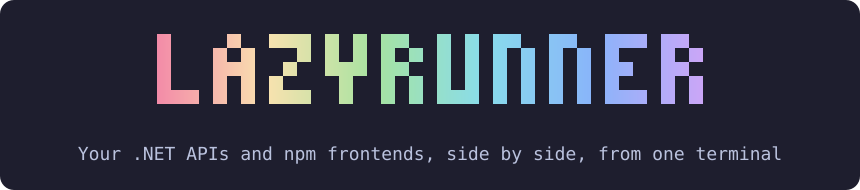
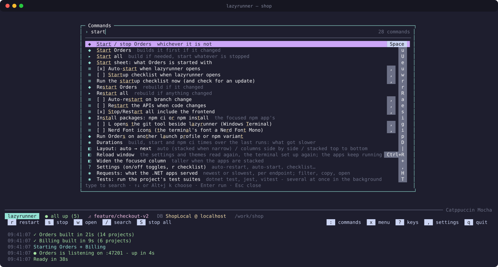
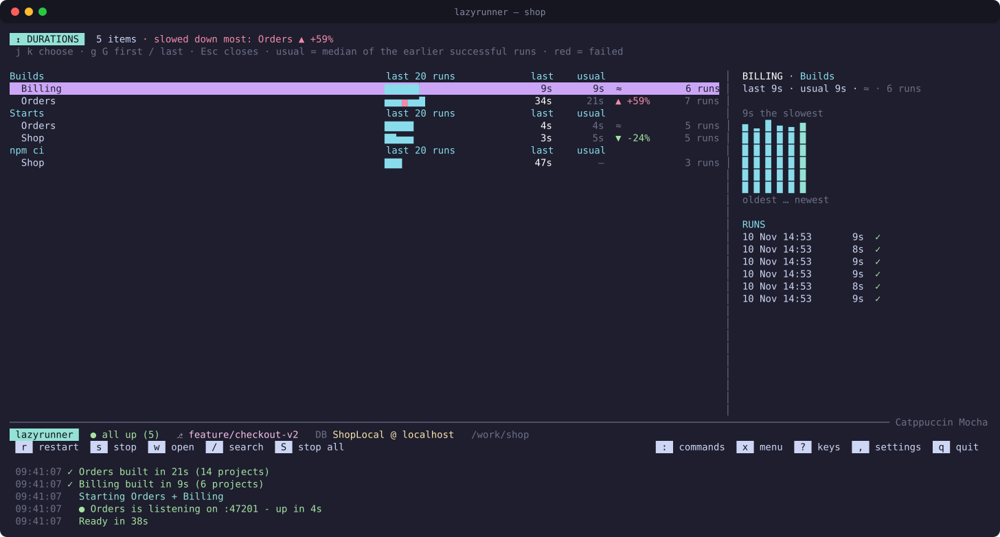
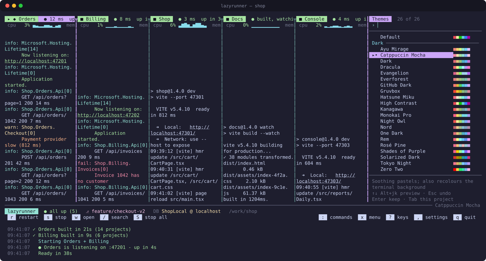
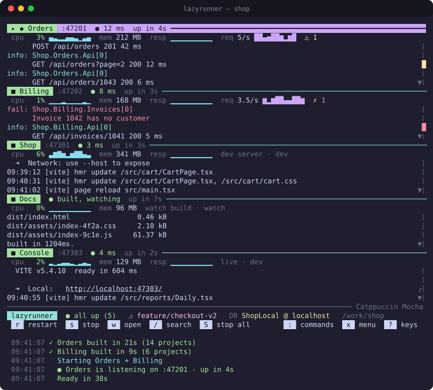
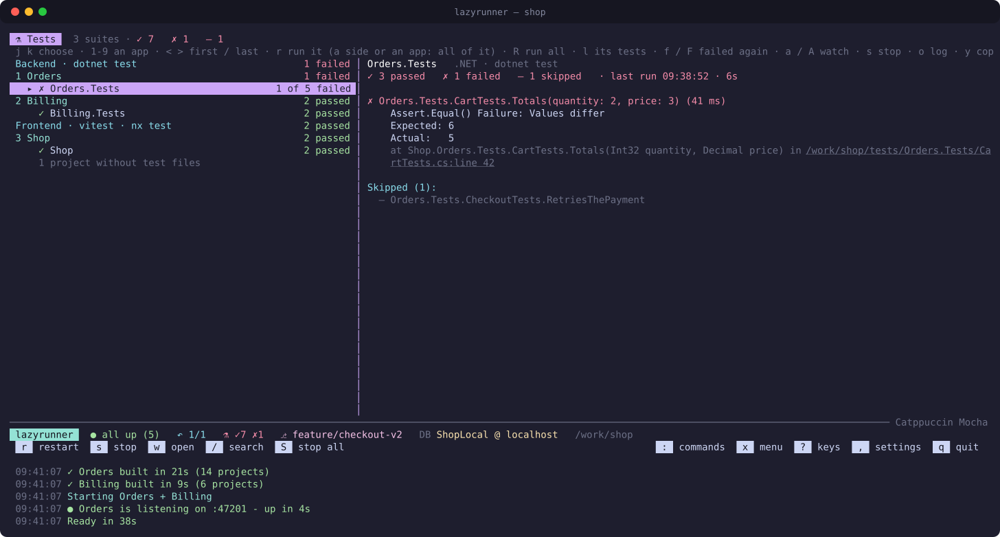
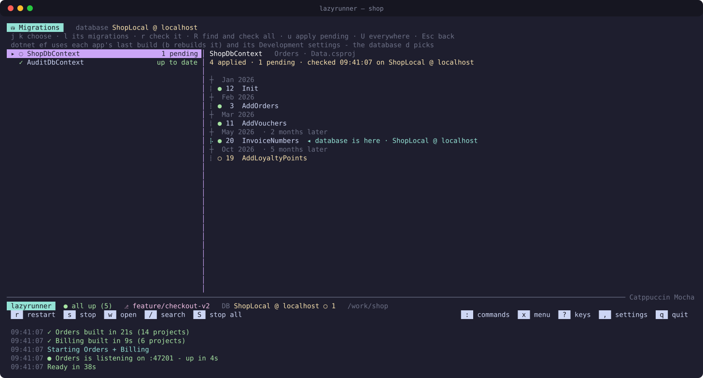
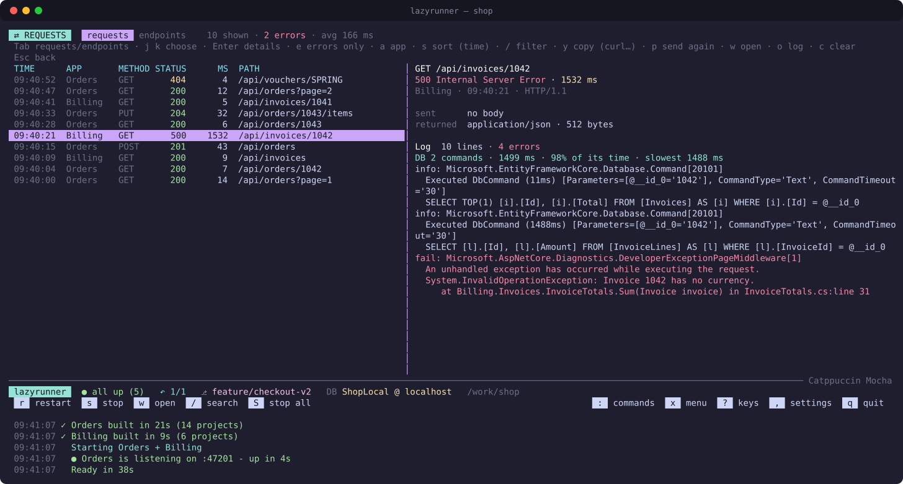
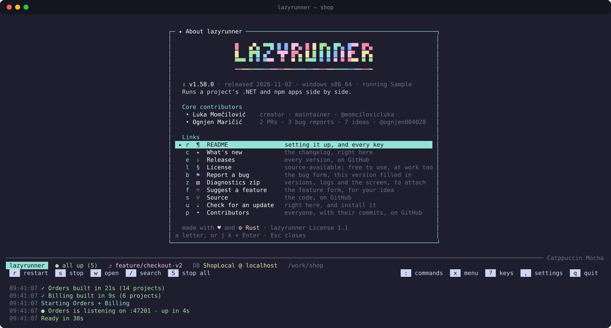

<p align="center"></p>

<p align="center">
  <a href="https://github.com/momcilovicluka/lazyrunner/actions/workflows/rust.yml"></a>
  <a href="https://github.com/momcilovicluka/lazyrunner/releases/latest"></a>
  <a href="https://github.com/momcilovicluka/lazyrunner/releases"></a>
  <a href="https://github.com/momcilovicluka/lazyrunner/blob/main/LICENSE"></a>
  <a href="https://github.com/momcilovicluka/lazyrunner/releases"></a>
  <a href="https://ko-fi.com/L4L2NNFN1"></a>
</p>

**Run your entire local development stack from one terminal.**

lazyrunner is a Rust terminal UI for running .NET APIs, npm frontends and any other command - a Python, Go or Rust
service, a queue emulator, a script - side by side. It builds what changed, starts
everything on the right ports, tells you when each app is up, and keeps live logs in columns you can scroll, search
and zoom.

Inspired by lazygit: one command instead of a row of terminal tabs.

<p align="center"></p>

> [!IMPORTANT]
> lazyrunner is source-available, not open source. It is free to use - personally, for a non-profit, or at work -
> under the [lazyrunner License](LICENSE). Redistributing it or selling it needs written permission.

## Features

- **One terminal for your stack** — run backend and frontend apps side by side.
- **Smart builds** — .NET builds run one at a time and skip unchanged work.
- **Live logs** — follow, search, and zoom each app's output.
- **Process management** — start/stop/restart apps while cleaning up child processes.
- **Project profiles** — keep stack setup in a shareable `.lazyrunner.json`.
- **Keyboard-first workflow** — fast controls inspired by lazygit.
- **Agent-ready** — `lazyrunner mcp` lets Claude Code read and drive the lazyrunner you watch.

## Quick start

Install lazyrunner, open a repository with your apps, then:

```sh
lazyrunner profile init --save
lazyrunner
```

Review the generated profile before the first run. See [Set up a project](#set-up-a-project) for profile details.

Windows binaries are published on the [releases page](https://github.com/momcilovicluka/lazyrunner/releases). Linux
and macOS currently build from source.

## Preview


<table>
  <tr>
    <td></td>
    <td></td>
  </tr>
  <tr>
    <td align="center"><code>:</code> the command palette</td>
    <td align="center"><code>D</code> how long builds and starts took</td>
  </tr>
  <tr>
    <td></td>
    <td></td>
  </tr>
  <tr>
    <td align="center"><code>t</code> themes, previewed live</td>
    <td align="center"><code>|</code> a narrow terminal stacks the apps</td>
  </tr>
  <tr>
    <td></td>
    <td></td>
  </tr>
  <tr>
    <td align="center"><code>T</code> the tests, run and read</td>
    <td align="center"><code>M</code> the migrations, applied and pending</td>
  </tr>
  <tr>
    <td></td>
    <td></td>
  </tr>
  <tr>
    <td align="center"><code>H</code> the requests the APIs served</td>
    <td align="center"><code>, A</code> about lazyrunner</td>
  </tr>
</table>


- **.NET apps** are built with `dotnet build` (one at a time, skipped when nothing changed) and run with their launch
  profile; the port comes from `launchSettings.json`.
- **npm apps** run their dev server or watch build; which script runs can differ per branch.
- Every app runs as a process tree lazyrunner owns (a job object on Windows, a process group on Linux and macOS): `q`,
  or even closing the terminal, leaves nothing running.
- What a project runs is described in a small JSON **profile** - in the repo (`.lazyrunner.json`) or in your own
  folder. `lazyrunner profile init` writes a first one for you.

## Install

In PowerShell:

```powershell
powershell -ExecutionPolicy Bypass -c "irm https://github.com/momcilovicluka/lazyrunner/releases/latest/download/lazyrunner-installer.ps1 | iex"
```

It puts `lazyrunner.exe` in `%USERPROFILE%\.local\bin` and adds that to your PATH. On Linux or macOS, build it from
source (with [Rust](https://rustup.rs)): `cargo install --locked --git https://github.com/momcilovicluka/lazyrunner lazyrunner`.

Then open a new terminal and run `lazyrunner` in your repo. A shorter name: add an alias of your own
(`Set-Alias lr lazyrunner` in your PowerShell profile, `alias lr=lazyrunner` in your shell's).

**Updating:** lazyrunner updates itself. When it opens, its startup checklist (or a quiet check when the checklist is
off, in the background) asks the GitHub releases for the latest version, installs a higher one, reopens on it and shows
what's new; `lazyrunner update` does the same on demand. With apps running, the new version takes them over when it
opens (Windows): they keep running, on the same ports, with their output. Downloads come over HTTPS only, the release's SHA-256
catches a broken download, and the new binary has to run before it replaces the old one. `,` then `v` (or `"autoUpdate": false`) turns it
off; `lazyrunner version` shows the version and where updates come from.

**Requirements:** git; the .NET SDK for .NET apps and Node.js / npm for npm apps (nvm works). Any terminal works;
Windows Terminal is best (tab colours and progress).

## Set up a project

lazyrunner needs a profile that says what your project runs. In your repo:

```sh
lazyrunner profile init          # prints a first profile from what it finds: .NET projects with a launch profile, npm dev scripts
lazyrunner profile init --save   # writes it to .lazyrunner.json
lazyrunner profile check         # checks it against the repo: projects, launch profiles, scripts, ports
```

A small one looks like this:

```json
{
  "schemaVersion": 1,
  "id": "shop",
  "name": "Shop",
  "watch": ["services"],
  "apps": [
    { "key": "api", "name": "API", "type": "dotnet", "project": "services/Api/Api.csproj", "launchProfile": "Api", "swagger": "/swagger" },
    { "key": "web", "name": "Web", "type": "npm", "dir": "web", "variants": [{ "script": "dev", "port": 5173 }] }
  ]
}
```

Commit `.lazyrunner.json` to share it with your team, or keep it in your own profiles folder (`projects` in the
settings folder, below) for yourself. The first time lazyrunner meets a repo's profile (and whenever it changes) it
shows what it would run and asks you to trust it. [projects/README.md](projects/README.md) is the full guide: where
lazyrunner looks, every field, recipes (watch builds served by an API, per-branch variants, a team's changes to a
profile), and how to write a profile for any repo - written so an LLM can follow it too.

## Example stacks

- **.NET API + React/Vite frontend**: one `dotnet` app and one `npm` app variant (`dev`, `port`).
- **Multi-service backend**: multiple `dotnet` apps in one profile, each with its own launch profile and port.
- **Frontend watch build served by API**: an `npm` watch variant with `servedBy` and `ready.file`.
- **Anything else**: a `command` app - a Python, Go or Rust service, a queue emulator, a script - with its `run`, and
  as much of `port`, `build`, `install`, `ready` and `watch` as it needs (below).

See [projects/README.md](projects/README.md) for full examples and recipes.

## Commands

```
lazyrunner            open lazyrunner in this terminal and start everything (unless auto-start is off)
lazyrunner start      the same, but always starts; if lazyrunner is open in another terminal, starts what is stopped there
lazyrunner stop       stop everything in the open lazyrunner (also cancels a running build)
lazyrunner restart    stop, rebuild if anything changed, run again
lazyrunner profile …  init / check a project profile (above)
lazyrunner update     update lazyrunner now (also when auto-update is off)
lazyrunner version    the installed version, where updates come from, and what's new in it
lazyrunner mcp        an MCP server for an agent such as Claude Code (below)
lazyrunner help
```

`lazyrunner start` in another checkout of the same project while lazyrunner is open switches it there; in another
project's checkout it reopens there, with that project's apps and settings.

## Keys

The keys follow vim and lazygit. Letters are case-sensitive: **lowercase acts on the focused column, uppercase on
every app**. `?` shows them all, and `:` (or `Ctrl+P`) finds any command by name.

The line under the header shows the keys that matter now, as keycaps: on the left what the focused app can do as it
is - start or build it stopped, restart, stop or open it running, cancel what it's busy with, look at what went wrong
when it crashed - with search and start or stop all, and the alerts (a port in use, a changed package-lock.json); on
the right `:` commands, `x` the focused app's menu, `?` keys, `,` settings and `q` quit, which give way first in a
narrow terminal.

The command palette lists every command and setting with its keys as keycaps, grouped (Run, Tools, View, Help,
Settings) until you type; then the best matches come first with the typed letters lit. What acts on the focused app
names it and shows its icon ("Start Orders"). The selection bar slides to the chosen row, and Enter runs the command
at once while the palette wipes away.

**Run**

| Key | Action |
|-----|--------|
| `space` | Start or stop the focused app, whichever it isn't |
| `u` / `U` | Start the focused app / start everything (builds first if the code changed) |
| `s` / `S` | Stop the focused app (or cancel its build or `npm ci`) / stop everything, cancelling a running build - `S` also cancels it from inside the `,` and `x` menus, which stay open |
| `r` / `R` | Restart the focused app / everything (rebuild if anything changed) |
| `b` / `B` | Build the focused app / every app that builds (but the ones `S` leaves running): a full build, never skipped, that leaves them **stopped** (a running one is stopped first - it locks its build output). `u` / `U` then start them without building again. npm apps have no separate build step |
| `!` | Kill whatever holds a port the apps need (offered when a port is taken); with no port in the way, the port map (`P`) |
| `q` / `Ctrl+C` | Quit: stop everything, back to the prompt |

**Tools**

| Key | Action |
|-----|--------|
| `d` | **Database picker**: switch the active connection string in the .NET apps' user secrets (below) |
| `i` | Install an npm app's packages in the background: `c` `npm ci`, `n` `npm install` (it stops the app first and starts it again after) |
| `w` / `W` | Open the focused app in the browser (Swagger for an API) / open everything |
| `o` | Open the focused app's full log file (or the failed build's log) |
| `p` | Run the focused app on another launch profile (a .NET app's, from its `launchSettings.json`, with their URLs) or npm variant: `Enter` restarts it on the one picked (`●` marks the one it runs), remembered for this branch in lazyrunner's state, not the shared profile. Its column's title says so (`Orders · Orders-Https`); picking the profile's own forgets the choice |
| `e` | The start sheet: what the focused app is started with - the command line and its folder, the launch profile (its URL) or npm script, the profile's `args`, its environment and the user secrets with their values masked (`Space` shows the picked one for 5 s; a connection string reads `database @ server`). Each variable says where it comes from - `launch`, `profile`, `secrets` or `override` - the one that wins with what it hides under it (a launch profile's variable wins over the profile's `env`, as `dotnet run` has it). **Overrides** are what the app gets on this machine on top, kept in lazyrunner's state and never in a shared file: `a` adds one (`NAME=value`), `Enter` overrides the picked variable (a user secret through its `Section__Key` variable), `d` drops one, `b` keeps one to this branch or gives it back to every branch, and `s` moves one that looks like a secret into the app's user secrets (a value that looks like one is masked, and the log says it's kept in plain text). A .NET app gets them as `dotnet run -e`, which beats its launch profile; an npm app in its environment. They apply from its next start, and its title says `env*` while it has any. `v` shows only the overrides, `V` copies them as what they change. A part that changed since the app started says so, and `r` restarts it; `y` copies the sheet, secrets masked |
| `y` | Copy from the focused app's output - it asks what: `y` the last error with its stack trace (a failed build's errors with full paths), `e` every error, `w` every warning, `a` both in order (repeats once), `s` the search match, `o` all of it |
| `D` | **Durations**: how long each build, app start, `npm ci` and test suite took over its last runs (below) |
| `M` | **Migrations**: the EF Core migrations, applied and pending, per DbContext; apply or roll back (below) |
| `A` | **Audit**: outdated and vulnerable packages, per app, and what fixes each (below) |
| `P` | **Ports**: every port the apps want, who holds it, and what to do (below) |
| `K` | **Stack**: which app calls which, and how those calls go; `Tab` the **code map**: what depends on what in the code; `Tab` again its **health**: each app against its targets, its alerts (below). `K` opens on the tab used last |
| `H` | **Requests**: the HTTP requests the .NET apps served, per endpoint too (below) |
| `T` | **Tests**: the project's test suites - run them in the background, see what failed, run one test (below) |
| `L` | **lazygit** (or your `gitTool`) without leaving lazyrunner (below) |
| `x` | Menu of everything you can do with the focused app |
| `,` | **Settings** menu (below) |

**Moving around and view**

| Key | Action |
|-----|--------|
| `h` / `l`, `Tab` / `Shift+Tab`, `←` `→` | Focus the previous / next column |
| `1`-`9` | Jump to a column |
| `j` / `k`, `↓` `↑` | Scroll the focused column one line |
| `Ctrl+d` / `Ctrl+u`, `Ctrl+f` / `Ctrl+b`, `PgDn` `PgUp` | Scroll half a page / a page |
| `gg` / `G` (`Home` / `End`) | Oldest output / follow new output again |
| `Ctrl+O` or `Alt+←` / `Alt+→` | Jump back to where you were before a jump, / forward again - as an editor's jump list. A view opened (`H` `T` `M`), `gg` / `G`, a search match, a mark or a scroll of more than half a page is a jump; the place you land on flashes, and the header shows `↶ 3/12` while there's somewhere to go back to (at most 50 places; one whose line is gone is skipped) |
| `/`, `n` / `N`, `Esc` | Search the focused column (matches highlighted), older / newer match, clear. While typing: `Tab` shows only the matching lines (a line either side), `Alt+r` takes it as a regex, `Alt+c` minds case; the prompt counts the matches. `/` again brings the column's last search back |
| `z` | Zoom: only the focused column |
| `~` | The timeline: every app's output in one list, in the order it came - each line tagged with its app and coloured by its level, a quiet stretch of more than 3 s as a dim `· 4.2 s ·` row. `j` `k` scroll (the bottom row is the picked one), `G` follows new output, `Enter` jumps to the picked line in its own column. `/` narrows it to lines holding some words, `app:orders` to an app's lines, `level:warn` to warnings and up; `f` cycles the levels as in the columns; `Esc` shows every line again. A request's lines are bracketed by a faint rule with its method, path and status. A strip down the right edge has a lane per app over the whole stretch kept, shaded by how busy it was, red where it logged an error, with an edge beside the time on screen |
| the rail | A column with more lines than rows has a rail at its right edge in place of a scrollbar: a map of all its lines - errors red, warnings yellow, search matches cyan, marks magenta, the rest dim ticks - with a bracket on the lines on screen (`▼` while it follows new output). The rest is dotted by how fast the app logged it: a dotted line at its usual pace, fuller where it logged faster, brighter where a burst came. A click on the rail jumps there, a drag along it scrolls, and the pointer on a row previews the line it jumps to, over the column. A new error that lands off-screen sends an ember down the rail to its mark, which waits for it and then settles in; `G` sends a shimmer down the map from where the view was, then down the bracket to its `▼`, a search's jump pulses its row, and the rail's top end dims while the oldest lines drop out of the buffer (not with reduced motion) |
| `H` `T` `M` `A` chips | What's new since a view was last open, in the panel's header: `H 3 new errors` (requests that failed since), `T 2 suites done · 1 red`, `M 1 pending` (a migration that appeared), `A 3 new findings · 1 critical` (what an audit scan found). The view's key or a click on the chip opens it on the first new thing; having it open clears the chip. While the audit or the migrations view is closed, what it does in the background has a chip too: `A ⠋ scanning 2 of 5`, `M ⠋ checking · 2 left` |
| `,` `A` then `z` | **Diagnostics zip**, in the About box under Report a bug: what to attach to a bug report - lazyrunner's and the tools' versions, the apps and their states, the settings and the profile with their secrets masked, each app's last 1000 lines and lazyrunner's log (passwords in connection strings, URL credentials and bearer tokens masked), and the screen as a picture. In the project's state folder (`diagnostics`); the log says where, and Alt+click on its path there (a click with `l` off) shows it in its folder. Look over its logs before you share it |
| `m`, `[` / `]`, `'` | Mark the line at the bottom of the focused column (or the search match it is on; `m` again unmarks), jump to its older / newer mark, list every column's marks, oldest first (`Enter` jumps, `a` writes a note, `y` copies them all as a timeline - time, app, note, line - `d` unmarks). Marked lines show a `▌`; marks and their notes go when the app starts again |
| `f` | Filter the focused column by level: errors only → warnings and errors → info and up → all lines again. Its top row says how many lines it hides; kept for the app between runs |
| `Alt+b` | The build as a map: the Code tab's projects with the running build, else the last one, over them - each project's state and own time, the critical path in the accent colour; `w` follows what's compiling, `B` shows the build's projects alone (below, "The build map") |
| `Alt+d` | What's new since the app's last run, in the focused column: the lines the last run printed too dim (times, durations, ports and ids don't count as a change), new ones keep their colour - `▲` before a new error or warning, `●` before any other new line - and the top row counts them: `+2 new errors · 3 fixed · 41 new lines` (`fixed?` until the app is up). `n` / `N` step through the new errors and warnings (the new lines when there are none); the rail marks only what's new and sends its ember only for a new error. The last run is kept when lazyrunner quits, so the first run after it compares too. `Enter` lists what was fixed: the last run's errors and warnings that didn't come back. A run with new errors puts a chip in the panel's header - `1 Orders +2 new errors` - whose number (or a click) opens that column this way, on the first of them. A good build says how its warnings changed since the last good one - `12 warnings (+3)` - and lists the new ones under it. `Alt+d` again shows all |
| `+` / `-` / `=` | Widen / narrow the focused column (taller / shorter when stacked) / make all equal (saved) |
| `<` / `>` | The first / last: the oldest output and following new output again in a column, the first and last item in a list or box (as in lazygit) |
| `\|` | Layout: auto (stacked below 120 cells) → columns side by side → stacked top to bottom (saved) |
| `Ctrl+L` | Clear all columns and the panel log |
| `Ctrl+R` | **Reload window**, like VS Code's: reads the settings and themes again, sets the terminal up again (screen, mouse, tab, colours) and repaints - with a little CRT show (none with reduced motion). The apps keep running. Handy after editing a setting or a theme by hand, or when the terminal got garbled |
| `t` | Theme picker: preview each theme live, `Enter` keeps one (saved), `Esc` undoes; see [Themes](#themes) |
| `?` | Key reference |
| `:` / `Ctrl+P` | Command palette: fuzzy-find any action or setting; `↑` `↓` (or `Alt+j` / `Alt+k`) choose. With nothing typed, the five you ran last come first (Recent) |

**Settings (`,` then a letter)**, saved in `lazyrunner.config.json` (the letter highlights the setting it flips):

| Key | Setting |
|-----|---------|
| `a` | Auto-restart when the git branch changes |
| `u` | Auto-start when lazyrunner opens |
| `s` | Stop/Restart all include the npm apps (off: `S` / `R` leave them running) |
| `e` | Restart the .NET apps when code changes: once saving in the watched folder has been quiet for 2 s, rebuild and restart the running ones (npm apps have their own watchers) |
| `w` | Startup checklist when lazyrunner opens |
| `r` | Run the startup checklist now (and check for an update) |
| `p` | Reload the project profile (reopens lazyrunner; on Windows the running apps carry on, unless their entry changed) |
| `P` | Open the project profile in your editor (`"editor"`): the `.lazyrunner.json` lazyrunner runs, or your own |
| `v` | Auto-update lazyrunner when it opens |
| `m` | The mouse (below); off, the terminal selects text again |
| `f` | Reduced motion: nothing blinks, spins, glides or fades |
| `g` | `L` opens the git tool beside lazyrunner, in a Windows Terminal pane |
| `i` | Nerd Font icons (on by default): the title bars, the status line, the views' headers and marks |
| `o` | `M` checks the migrations against the database when it opens (off: `r` / `R` in it) |
| `l` | Links in the output open on Alt+click (on by default; off: on a plain click) |
| `c` | What's new: the changelog |
| `A` | About lazyrunner (below) |

**About lazyrunner** (`,` then `A`, or `:` about): the version and when it was released, who makes lazyrunner, and
its links - a letter (or `j` `k` and Enter, or a double click) opens the README, the changelog, the releases, the
license, a bug report with the version and OS already filled in, the diagnostics zip to attach to it (`z`), a
feature request or the source, or checks for an
update right there (`u`: what the check is doing, then how it ended, under its link; an update it finds is installed,
as the startup checklist does). Its logo shimmers in rainbow colours over a flowing rule (still with reduced motion), with Nerd Font icons
when they're on.

Every full-screen view - requests, tests, migrations, audit, ports, the stack and code maps, the timeline, durations -
starts the same way: its name in a chip, then its keys under it, on as many rows as they need - wrapped between keys,
so each key stays in one place, all of them there at a glance. The code map's lines under the map (what the picked
part uses and what uses it) wrap the same way. A
column's title that doesn't fit leaves out the app's port before its state, and a long output line wraps at a space or
punctuation when one is near the edge, so words and paths stay whole.

### Mouse

A click focuses a column; a double click on its title zooms it (again: back). A link in the output - a URL, or a
place in a file, which opens in your editor (`"editor"`) at its line - opens on Alt+click, so a click to focus a column
never opens one by accident; `,` then `l` makes a plain click open them. Ctrl+click works too where the terminal leaves
it alone: Windows Terminal opens the URLs it finds itself on Ctrl+click, row by row, so a wrapped one comes out cut. A
file's path may be relative to its app's folder (an Angular app's `libs/...`) or to the repo. The wheel scrolls the column under the
pointer, whichever has the focus. In the menus, the command palette and the database and theme pickers a click picks
an item and a double click runs it; a click outside a box closes it. What the
pointer is over lights up, and what you click shows pressed for a moment. While the mouse is on, the terminal leaves text selection to
lazyrunner, which has none: `,` then `m` turns it off (in Windows Terminal, Shift + drag selects either way).

### Motion

lazyrunner answers what you do at once, and shows it: the hint of the key you pressed and the column it acts on
flash, the column that gets the focus pulses, a box opens from its middle, a setting flashes as it flips, copied lines
light up in their column, the line the search jumps to flashes, and column widths and scrolling glide. Long work moves
for as long as it lasts: builds, starts, npm, tests and migrations have a spinner and a bar against the usual time,
and with `restartOnCodeChange` a saved change counts down to the rebuild. None of it holds you up - a key acts at once,
also during the startup checklist or the reload show, which it ends. Boxes grow to fit their longest row, and when
a selected row is still too long for the terminal its hint scrolls sideways to show the rest, its key and label staying
put. `, f` (reduced motion) turns it all
off.

A column's title moves as its app changes: coming up fills its chip green from the left, stopping drains the colour it
had from the right, and a crash pulses it twice - a glance across the titles says what just happened where. An empty
column says what its app is (`not started yet`, `stopped · started 10:42`, `exited · code 1`), the focused one what
starts it too. The panel's log keeps each line's mark (`✓` `×` `!` `▸`) in a column of its own, the newest line slides
in from the right, and a line too long for the panel scrolls sideways, its time and mark staying put. The settings
(`,`) show as switches - a green `●` on, a dim `○` off - grouped under Startup, Running, Display and Integrations when
there's room.

### During a build

.NET builds run one at a time; `R`, `B`, `r`, `b`, `U` and `!` wait for the current one (`S` cancels it). Everything
else keeps working: the database picker, `npm ci` next to the build, starting an npm app, `s` to cancel just the
focused app's build or take it out of the queue, and `q`.

## What it shows

- **Each column's title:** a spinner and progress bar while building or starting, with an estimate from previous runs
  (`23s / ~41s`); a pulsing dot until the app is up; then its URL, response time (`12 ms`, `slow 1.4s`, `not
  responding`) and how long it took to start. The response time comes from requesting the app's own health endpoint
  (`"health": { "path": "/healthz", "expectedStatus": 200 }`), else its Swagger page (`/` otherwise), every 5 s.
- **The layout:** the apps side by side, or top to bottom when the terminal is narrower than 120 cells (a Windows
  Terminal pane, a laptop screen); `|` picks one for good.
- **Each column's info line:** CPU and memory of the app's whole process tree with sparklines, requests per second for
  .NET apps, and error / warning counters.
- **Builds** show real progress: projects done out of those in the dependency graph (`23/41`), warnings counted
  instead of flooding the column.
- **Log lines** are coloured by level, and every app's full output is saved to `<project>/logs/<app>.log` in the
  state folder (below), so `o` lets you search all of it.
- **Links** in output are underlined: URLs, and places in files - a build error's `Orders.cs(12,5)`, a .NET stack
  frame's `in …\Checkout.cs:line 42`, a node or jest frame's `src/cart.ts:12:5`. A click opens a URL in the browser
  and a file at its line in your editor (`"editor"`); a bare file name is looked for in the project, outside build
  output and `node_modules`.
- **A scrollbar** on the right of a column with more output than fits shows where the lines on screen are; it is
  bright while the column is scrolled back (`G` follows new output again).
- **The terminal tab** title and progress show the overall state; **desktop notifications** cover a failed build, a
  crash, and a slow start finishing - while you're elsewhere: a terminal that says it has the focus gets none.
- **After "Ready"**, the log shows a startup timeline per app.
- **The screens** - Stack `K`, Requests `H`, Migrations `M`, Audit `A`, Tests `T`, Ports `P`, Durations `D`, Timeline
  `~` - each start with a bar naming them all with their keys, the open one lit (just the keys when the names don't
  fit). Another screen's key, or a click on its name, goes there on the app the open one is looking at - the Map's
  picked box, the requests' app, the migrations' context, the audited app, the picked suite or port - with its column
  focused: `M` on the Map shows the picked app's migrations, `H` its requests alone. A screen's own key still closes
  it; the tests keep `A` for watching them all (a click on Audit goes there). A screen with nothing to show yet says
  why and leaves you where you were.

## Startup checklist

When lazyrunner opens, a short splash checks for a lazyrunner update, git, the .NET SDK and Node.js / npm, whether the
apps' ports are free, whether the active database's server answers, each npm app's packages against its
`package-lock.json`, and which project and branch it runs. The checks run side by side. The apps don't wait long for
the update check: once everything else is done it gets 2 s more, then goes on in the background (an update it installs
is switched to when nothing is in the way). Problems also go to the panel log. Once every check is done, `r` runs the
ones that failed or warned again - a failed update, a port that was busy - without closing it; any other key closes it.
At startup it moves on by itself after a few seconds, the time left draining along its bottom edge. Opened by hand
(`,` then `r`), or once you've pressed `r`, it stays up while there is something to retry, until a key closes it.
Turn it off with `,` then `w`.

It's laid out as a doctor: a header with the project, a bar of the checks done (`7 / 10 checks`), how many passed,
warned, are blocked and were skipped, how long they took and the slowest; then the checks under their groups' headers:
Environment (lazyrunner, git, the .NET SDK, Node.js / npm), Project (the profile, the ports, the branch), Database,
Packages and Update - each header with its group's worst result and time, every group open unless the terminal is too
short for them all. Each check shows how long it took with a bar of that against the slowest, and a `FIX` tag when it
has one; a failed check has a red edge and a warning an amber one, a skipped one is dimmed. Beside the list (under the
picked check, on a terminal narrower than 118 cells) are the picked check's details: what it found, what its problem
holds up, the keys that fix it, and the other problems. A legend and the keys close it. Unless reduced motion is on it
moves too: the counts tick up as the checks finish and pulse as they change, each check's mark lands bright, the
selection bar glides between the rows (and flashes going round the end), and once nothing blocks the start a bar with
an hourglass drains with the countdown to it.

`j` / `k` (or a click) move through the checks as they're drawn, from the first; `n` / `N` jump to the next and
previous problem; a click on a check's `FIX` tag runs its fix.
It fixes what it can: `f` runs the picked check's fix (or the first problem's when it has none), `a` every safe one in
turn, and `i` ignores a problem for this run - it holds nothing and counts as skipped:

| Problem | `f` | With `a` |
|---------|-----|----------|
| An npm app's packages missing, or `package-lock.json` changed | `npm ci` for it, its last line on the check's | yes |
| A port another process holds | stops that process (only one that still holds it, never the system's) | no |
| A port Windows reserved | copies `net stop winnat; net start winnat` for an elevated terminal | no |
| The database server doesn't answer | the database picker, once the checklist closes | no |
| The update check failed | checks again | yes |

A fix that worked turns its edge green with a flash; one that didn't pulses red. At startup a failed check holds the
start until it's fixed or `Enter` starts anyway, and once nothing blocks it any more it counts down - `starting in 3 s`
- to the start; `Esc` holds it there. `c` copies it all as a Markdown report for an issue - lazyrunner's version, the
project and its apps with their ports and folders, each check's result and time, and what fixes the problems, with
secrets masked as in the diagnostics zip.

## Database picker (`d`)

.NET apps that use user secrets read their connection strings from `secrets.json` in the user secrets folder
(`%APPDATA%\Microsoft\UserSecrets\<id>\` on Windows, `~/.microsoft/usersecrets/<id>/` elsewhere). lazyrunner lists
every SQL connection string there as `database @ server`, never showing passwords. Choosing one makes that line active
and comments out (`//`) the others with the same key, checks the file is still valid JSON, keeps the previous version
as `secrets.json.lazyrunner-backup`, and restarts the running .NET apps (no build needed). `n` adds an entry: a copy
of the selected one with another database name; `y` copies the highlighted line as it is in the file,
password included.

## lazygit (`L`)

`L` opens [lazygit](https://github.com/jesseduffield/lazygit) in the project's folder without leaving lazyrunner. It
takes over this terminal; `q` in lazygit brings lazyrunner back. Meanwhile the apps keep running and lazyrunner keeps
watching them (a branch you switch to in lazygit restarts them as usual, if that setting is on), and quitting or an
update waits until you're back. With `,` then `g` in Windows Terminal, `L` opens lazygit in a pane beside lazyrunner
instead, so you see both. Another git tool: `"gitTool"` (for example `"gitui"`). lazygit has to be installed (`winget
install JesseDuffield.lazygit`, `scoop install lazygit`).

## Migrations (`M`)

`M` shows the DbContexts on the left and the selected one's migrations on the right as a rail, oldest at the top:
applied (`●`), pending (`○`), a `┼ Apr 2026` tick where each month starts (with how many months on, after a gap)
and each migration's day beside it, the older ones folded once they don't fit - and the database as a bead on the
rail, **database is here**, as the database the app uses has them. `dotnet ef` (`dotnet tool install --global dotnet-ef`) runs with the app's project as the startup project,
its Development settings - so the database you picked with `d` - and its last build (`b` rebuilds it); in the
background, waiting while an app builds. Contexts are checked three at once (`+` and `-` change it, 1 to 8, saved as
`migrationParallelism`); a check that fails beside others is checked again on its own, and a migration that's applied
or reverted always runs alone.

```json
{ "key": "api", "type": "dotnet", "project": "src/Api/Api.csproj", "launchProfile": "Api",
  "migrations": { "project": "src/Data/Data.csproj", "contexts": ["ShopDbContext"] } }
```

lazyrunner finds them by itself: the EF Core model snapshots (`*ModelSnapshot.cs`) in each .NET app's project and the
projects it builds, and the DbContext each is of - a project once, for the first app that builds it, which is the
startup project. `"migrations"` in an app's profile says where instead (above): `project` is the one with the
migrations (the app's own when left out), and without `contexts` its model snapshots name them, else
`dotnet ef dbcontext list` finds them.

Checking a context against the database takes `dotnet ef` a few seconds, so `M` doesn't by itself: `r` checks the
selected context, `R` finds the contexts again (a branch may add some) and checks them all. With
`checkMigrationsOnOpen` (`, o`) `M` checks them all each time it opens, and switching the database or the branch
checks them again. Each check is kept, per database, for the next run: a context shows its last check on the database
you picked - when, with the day once it isn't today - or "not checked" when it has none there. `l` chooses a migration, `m` moves the context to it - forward
applies up to it, back reverts the newer ones through their `Down()` - and `u` applies what's pending (`U`: in every
context); each asks first, naming the database.

Choosing a target lights the stretch of rail between the database and it: green with dashes flowing down to apply
(`applies 3`), amber flowing up to revert (`reverts 2 - may lose data`), with `⚠` on a migration whose `Down()`
likely drops what it added (its name starts with Add or Create) - the confirmation names those too. While `dotnet ef`
works the bead travels the rail as it reports each migration done - a hop at a time, faster when several finish at
once - and breathes while it works; each node it reaches fills (or empties, going back) with a glint, the list shows
`▰▰▱▱ 2/4`, a shimmer runs along the stretch once it's done, and where one fails the bead pulses red and the node
says why, the rest of the way to the target left cracked (`⠅`). A history the database couldn't be read for is drawn
dashed, with `◌` nodes and no bead. With reduced motion the bead steps and nothing flows. Outside `M`, the status
bar shows `○ 3` beside the database while migrations are pending on it.

## Audit (`A`)

`A` shows each app's packages that need a look, in three titled panes. **Apps**: each with its worst finding (`2 high`,
a filled capsule for a critical one, `↑ 3 outdated`, `up to date`). **Packages**: the selected app's - the vulnerable
first, the worst first, then the outdated, a new major version first - with their current and latest versions, their
severity in capitals (`CRITICAL` filled red, `HIGH`, `MODERATE`, `LOW`) or `↑ outdated only`, what a transitive one
comes in through (`lodash via RestSharp`) and whether the app references it itself; what the last scan fixed stays as a
`resolved ✓` row, and what it hadn't seen before is marked `new`. **Details**: the picked package's advisory - its
id, how the app gets it, its text and the versions it affects (npm says them; NuGet gives only the id), the version that
fixes it and its link (`Enter` opens it) - the others it has, and **what `i` will run**: `dotnet add Orders.csproj
package Newtonsoft.Json --version 13.0.4`, `npm install lodash@4.18.1` or `npm audit fix`, in the app's folder, with a
warning when that's a new major version. The details sit beside the table on a wide terminal, under it on a narrower
one.

`r` scans the selected app, `R` every app: `dotnet list package --vulnerable --include-transitive` and `--outdated`
for a .NET app (it needs a restore - a build does it), `npm audit` and `npm outdated` for an npm one (it needs a
`package-lock.json`). They ask the package feeds, so nothing is scanned until you ask: in the background, two apps at
once, the header saying which. They run below normal priority and MSBuild's workers don't outlive them, so a scan
never weighs on the apps or lazyrunner - each `dotnet list package` keeps an MSBuild worker per core busy, so a .NET
app's two run one after the other (an npm app's side by side). `+` and `-` change how many apps (1 to 8, saved as
`auditParallelism`) - fewer when a feed refuses a burst of requests. A scan that fails beside others is scanned again on
its own once the rest are done; only then does it count. Each scan is kept in the state folder (`audit.json`), so `A`
opens on the last one and says how old it is; a scan that fails keeps the one before, and its time, and says why.

`l` (or `Enter`) goes into the packages and `h` back to the apps; `/` filters the packages by name, `v` shows only the
vulnerable ones, `e` puts each vulnerable package's advisory on a line under it (`└ title · fixed in 13.0.4 · +2 more`); `y` (or `u`) copies the picked package's fix, `Enter` (or `o`) opens its advisory, and `i` installs
the fix after a yes (`y` or `Enter`; `n` or `Esc` doesn't) - the app stops first if it runs and starts again after,
then it's scanned again. `I` installs many fixes together, after asking which: `c` the critical ones, `h` high and
up, `m` moderate and up, `a` all of them (`n` none) - the question says how many each takes and how many are a new
major. The app stops once, an npm app's fixes go in one `npm install`, a .NET app's one `dotnet add package` after
another, each package once. `Esc` goes back out of the packages, then drops the filter, then closes (`q` and `A` too).
A name too long for its column ends in `…`; a finding the last scan added has its `new` chip after its
severity, where it hides nothing.

Each vulnerable row has an edge in its severity's colour and its severity framed (`▕HIGH▏`); an outdated-only row is
dimmed, the red meaning advisories. `/` lights the part of each name it matches. While `R` scans, the header counts the
apps off (`2 of 5 done` and a bar), and when it's done the log says it in one line: `▸ Audit finished in 3.8s · 12 packages
· 3 high · 1 critical`. The header's last scan is green today, amber after a week and red after a month (`R rescans`).
A fix being installed spins in its own row, and one that failed pulses the row red; `y` lights the command it copied.

A column's title says `⚠ 2 high` while its app's last scan found something high or critical, and the startup
checklist's Vulnerabilities row says the same from the kept scans - it never scans itself - with `f` opening `A`. It
moves (not with reduced motion): its rows come in one after another as it opens, the table dims while its app is
scanned, the rows that changed light up as the scan lands, what it fixed flashes green, and a new high or critical
finding pulses once; with reduced motion a changed row keeps an accent edge instead.

## Ports (`P`)

`P` shows every port the apps want (their launch profiles' URLs, the npm dev servers' ports) and who really holds
each, read from the system. The header counts the conflicts, and an occupancy strip gives every port at a glance - a
cell each, in the table's order: green free, blue its own app, red something else, hatched reserved. Then the table,
the conflicts first:

| Column | |
|--------|---|
| **port**, **app** | `47202  Billing` |
| **holder** | the process, its PID and command line: `node.exe (PID 4120) · node vite --port 5173` (the picked row's scrolls when it's long) |
| **state** | `●` free · `◐` its app, running here · `×` held by other · `∅` reserved by Windows - no app can listen there |
| **for** | how long it's been so |
| **the last minute** | who held it, a cell every two seconds - whose process keeps grabbing it (on a wide terminal) |
| **action** | what to do: `! stop it · since 09:39:58`, `Enter its column · w opens`, `its next start lands here` |

The keys sit under the header, as in the other views, and a status line under the strip says what's wrong:
`▲ 47202 conflict since 09:39:58 · node.exe holds Billing's port - ! stops it`. The ranges Windows reserved are listed
under the table, the apps' ports in them marked.

`!` stops what holds the picked port (after a yes; never the app itself): its row dims and spins until the port is
free. `Enter` goes to its app's column, `w` opens the port in the browser, `r` reads the ports again and `y` copies
what frees the reserved ranges (`net stop winnat; net start winnat`, in an elevated terminal). `Esc`, `q` or `P`
closes it. The ports come from the snapshots lazyrunner takes anyway, once a second; nothing else is sampled. With no
port in the way, `!` anywhere opens it too.

While it's closed, a stopped app's port that something else has held for a few seconds puts a chip in the panel's
header - `! 5001 taken`, lighting up once as it appears - so the clash is known before the next start; a click opens
`P` there. It moves (not with reduced motion): the strip fills left to right and the rows come in one after another as
it opens; a port that changes flashes its state and its cells; a new conflict slides in with a red edge that pulses
twice, and pulses while `!` asks about it; a freed port wipes out what held it while `● freed` draws in, then flashes
green.

## Stack (`K`)

`K` maps which app calls which. The apps are boxes - each with its state and port - in columns by who calls whom: a
caller left of what it calls, level with it so the line runs straight, the apps with no edge last. The database (the
one `d` picked) comes after the apps that use it - a project they build references EF Core or a SQL client, they
have migrations, or their requests ran database commands - with their commands a minute on its edge, dashed until
the first one.

The edges come from what really happens: lazyrunner turns on HttpClient's log for the .NET apps it starts
(`--Logging:LogLevel:System.Net.Http.HttpClient=Information`), and each call's url names a port, so the app that
listens there. No setup, and it shows calls nobody wrote down. The npm apps get the same: lazyrunner starts them
with a small Node hook (`NODE_OPTIONS=--require <state folder>/call-hook.cjs`, added to any `NODE_OPTIONS` of
theirs) that listens on Node's own diagnostics channels and writes a line for each call to a port on this machine -
a dev server's proxy to an API - with its status and time; lazyrunner reads it and keeps it out of the column. Until
an npm app's calls are seen, its own config links it: a proxy file (`proxy.conf.json`), a bundler's config, an
`environment*.ts` or a `.env` that names another app's port (`localhost:5000`), read as `K` opens; with no call seen
at all, its edge's figures are what the called app served, marked `~`. The profile's `dependsOn` declares the rest:
`"dependsOn": ["orders"]`. A declared edge is dashed until it carries anything.

Each edge is coloured by its last minute - cyan with calls, red with a failure (a 5xx, or no answer in 30 s), grey
once seen - with its calls on it (`3/min`, `12/s`). An edge to the next column runs between the boxes, each edge of a
box on a row of its own, in the order of where its other end is; one blocked by a box goes around it, never behind
it - through the nearest gap between the boxes it passes, so it stays close to its ends, and only under them all when
there's none nearer. Each box says as much as fits - the more room (fewer apps, a bigger terminal), the more, and with many apps just
the name and state, so nothing overlaps:

| Detail | .NET app | npm app | Database |
|---|---|---|---|
| always | name, state (building `12/41`, waiting to build, up...), port | the same | its name |
| 1 | how long it has run, CPU and memory, requests a minute with their p95 and 5xx | the same, with the calls its proxy made a minute (the Node hook) | commands a minute and their time |
| 2 | the errors and warnings it printed | the same | the slowest command, the requests that look like an N+1 |
| 3 | its slowest endpoint, its last build (`built 4m ago in 22s`) | the `npm run` script and variant it runs | |
| when there's any | what waits on it in the other screens, with their keys: migrations to apply `(M)`, failing tests `(T)`, its worst vulnerability from moderate up `(A)`, and 5xx in the last minute `(H)` where the box doesn't say its minute already | the same | |

A line too long for a box (an endpoint) scrolls through. Under the map, every edge's figures over the last minute: calls, p95 and
failures, the picked app's bright. `h` `j` `k` `l` choose an app, `Enter` (or a double click) goes to its column,
`H` `M` `A` `T` `P` open its requests, migrations, audit, tests or port, `Esc` closes. It moves (not with reduced motion): the edges draw in as it opens, a dot travels along each edge that carries
anything - faster the more it carries; white, yellow on a failing edge, cyan to the database - and an edge's new
failure pulses it twice. The MCP's `get_stack` gives an agent the same
map, with the newest failed calls (url, status, or no answer).

### Code map (`K` then `Tab`)

The stack view's Code tab maps what depends on what in the code itself - both sides of the stack, read in the
background as it opens (and again a moment after a save while it's open), with patterns, no compiler. Each file is
read again only when it changed: what was read is kept in the state folder, so the map comes back quickly next time.

- **Apps:** it opens on the profile's apps, one linked to another when its code uses the other's projects, and two
  that share projects dashed with how many (`35 shared`); each says its files and projects. `Enter` shows an app's
  projects alone - its own and all they depend on - and `a` all of them.
- **.NET:** every `.csproj` under the root (and those the apps reference), linked by their `<ProjectReference>`s; each
  says what it is (app, library, tests - a library with its tests inside, that others reference, stays a library),
  its target framework, files and packages.
- **TypeScript:** in each npm app's folder its projects - an Nx workspace's (each folder with a `project.json`, with its
  tags), or the app itself - linked by their imports, through the `tsconfig` `paths` aliases or a relative path into
  another project; a dynamic `import()` (a lazy route) is dashed. Each says its files and its NgModules and components.
  In an Nx workspace, `nx graph` is asked too (after the map shows, in the background): the dependencies only Nx
  knows of - `implicitDependencies`, a plugin's - join the map dashed in blue.

`Enter` goes inside a project - a .NET project's namespaces linked by their `using`s, a TypeScript project's source
folders linked by their imports - and inside a folder, to its NgModules and components, linked by their
`imports: [...]`; what a level uses from elsewhere is dashed and dim, with where it is (`in @focus/components`).
`Backspace` goes back out. A cycle is red, its boxes too; `c` steps through them. A link a rule doesn't allow is yellow,
with a `✗` on it, and the header counts them: the profile's `layers`
(`"layers": { "*.Api": { "mustNotReference": ["Orders.Data"] } }` - a project's name, `*` for anything, and what it
must not reference) and an Nx workspace's module boundaries (`.eslintrc.json`'s `depConstraints`, by the projects'
tags).

**Finding your way in a big map:**

- **`/` searches** every level - apps, projects, namespaces, folders, modules, components - and the source files, by
  name (the name itself first, then one it starts, then one it holds); `↑` `↓` choose, and `Enter` goes to it and
  shows **its graph**: it, all it depends on and all that depends on it, nothing else (a file's is its namespace's, or
  the module or component declared in it; a module's goes through the modules that import it in any folder or
  project). `g` shows the picked box's graph the same way; `g`, `Esc` or `Backspace` leave it.
- **Implied edges are hidden:** when A uses B and B uses C, A's own line to C says nothing new, so it's left out (the
  line under the keys says how many); `r` shows them all.
- **`f` focus** keeps only the picked box and its neighbours, with their lines to it alone (`+` `-` how far) - on by
  itself on a level of more than 24 boxes.
- **`z` zooms out:** compact boxes (their names alone, long ones cut in the middle: `SettingsModu…Controllers`), then
  an overview - just the names, with only the picked box's lines - and `Z` back in.
- `t` hides the test projects. Lines from different boxes that cross hop each other (one runs on through), so a
  crossing doesn't look like a junction, and the picked box's lines are drawn on top. A map bigger than the room has a
  minimap in its corner, the part in view brighter.

`o` opens a box's file, `y` copies its path, `Tab` goes on to the Health tab, and on the Map `c` opens the Code tab on the
picked app's projects. Under the map, the picked box: what it depends on and what uses it (directly, and in all) and by
name, what a change to it affects - how many projects and test projects - its tags, the rules it breaks and what only
Nx links it to. Like the Map, the boxes say as much as fits. With motion on, a level zooms in (its boxes growing) or
out (shrinking), its edges draw in outwards from the picked box a step at a time, and focus dims what it's about to
hide before it goes. `using`s are matched to projects by their namespaces, not by a compiler.

**The build map** (`b` on the Code tab, `Alt+b` from anywhere, `Enter` on a build in the durations `D`): a .NET app's
build over its projects - the running build, else its last. Each project the build compiles says how it's doing:
queued, building (spinning), `✓` with its own time - from when the last project it references was done - `✗` failed,
or not built when the build stopped first; projects the build doesn't have are dimmed. The **critical path** - the
chain of references that decided how long the build took - is in the accent colour, and the row under the keys says
`Orders built in 52s · critical path 38s of 52s` (or how far a running build is). Under the map the picked project
says its time in this build against its usual, and whether it's on the critical path. Where it comes from: the
`<ProjectReference>`s, and MSBuild's own `Project -> output.dll` lines, stamped as they arrive - no new tooling. Each
project's own time goes into the durations (`D`, **Projects built**), so they say which project got slower; an app's
last build is kept, so `D` opens it in the next session too. `b` again hides it.

**Following the build** (`w`): the picked box stays on a project compiling now - the map scrolls with it - and once
it's done moves on to the next one compiling (the one that could start first), until the build is over, when it goes
back to the box picked before. A running build opens followed; moving about by hand, or `w` again, stops it. `B`
shows the build's projects alone - built, building and still to build, with their links - without the projects and
parts it doesn't build; `B` again shows everything.

**The Health tab** (`K`, then `Tab` from the Code tab): is the stack well? A card per app, in the profile's order: its
p95 latency and 5xx rate over the last minute (the .NET apps whose requests are logged), its memory and CPU - each
against its target, with a braille sparkline that has the target dotted across it and what's over it in red, the
reading amber near the target and red over it. A reading over its target fills a bar on the card toward an alert; one
that lasts a minute **is an alert**: the log says `! Orders p95 1240 ms, over its 1000 ms target for 1m00s`, the app's
title flashes twice and its column's border stays red, a desktop notification goes out (while you're elsewhere), the
panel shows `! K 1 alert` (a click opens the tab), and the terminal tab's progress turns red. Memory that grows more
than a fifth over a minute - the title's `↗` - is an alert at once. `a` on a card acknowledges its alerts: amber until
the app recovers, when the log says `✓ Orders p95 back under 1000 ms after 4m10s` and its card glints green. A stopped
app's breaches go without a word. Under the cards, the slowest endpoints of the last five minutes by p95, as bars with
their app's target ticked across; `Enter` on one opens it in the requests view's Endpoints tab (`H`), on a card goes to
its column. The targets come from the profile, per app, else p95 1000 ms, 5% 5xx, 2048 MB and 90% CPU:

```jsonc
{ "key": "orders", "type": "dotnet", "health": { "p95Ms": 500, "errorRate": 0.02, "memoryMb": 1500, "cpuPercent": 80,
  "path": "/healthz", "expectedStatus": 200 } }
```

`path` is the app's own health endpoint, which the response-time probe asks for instead of the Swagger page; with
`expectedStatus` another answer counts as not responding.

## Requests (`H`)

An API that logs through Serilog (or anything else that replaces ASP.NET's logging) to somewhere other than the
console - Seq, Application Insights - prints no request for lazyrunner to read, and the view says which one when it
stays empty. `"args"` in that app's profile passes it what turns that off for local runs, after `dotnet run ... --`;
an app that only logs to Seq when it has a Seq key, say:

```json
{ "key": "api", "type": "dotnet", "project": "src/Api/Api.csproj", "launchProfile": "Api", "args": ["--Seq:ApiKey="] }
```

lazyrunner starts the .NET apps with ASP.NET's request log turned on (`--Logging:LogLevel:Microsoft.AspNetCore.
Hosting.Diagnostics=Information`) and keeps those lines out of the columns: `H` lists the requests instead - time,
app, method, status, milliseconds and path, newest first (`s`: slowest first). Serilog's request logging (`HTTP GET /x
responded 200 in 12 ms`) shows too. `Tab` sums them up per endpoint (ids and user names like `jo@contoso` in paths
become `{id}`): count, errors, average, 95th percentile and slowest, sorted by total time (`s` for the others).

`Enter` (or `Space`, or a double click) shows the selected row's details in a panel on the right, and again hides
it; `Esc` hides it too. A request's: its status,
time, protocol, what it sent and returned, and - once its endpoint has a few requests - how it compares with them (p50,
p95). Below, what the app logged while it ran, from ASP.NET's "Request starting" line to its "Request finished" one:
the line count, the errors, the EF Core database commands (`Executed DbCommand`: how many, their total time and its
share of the request's, the slowest), then the lines themselves, the newest that fit. lazyrunner starts the .NET apps
with their console log's scopes on, so each entry says its request's `RequestId` (lazyrunner keeps those scope lines
out of the columns): a request's lines are then exactly its own, even when requests overlap. An app that logs no
scopes gets the lines between its request's start and finish; when other requests ran at the same time some of
those may be theirs, and the panel says so. An endpoint's: count and errors, average,
p50, p95 and slowest, a sparkline of its latest times, its statuses, its slowest and its latest failing requests.
Serilog's request log has no start line, so its requests come without their log lines.

A request that runs the same query 10 times or more (its parameters aside) looks like an N+1 - a loop loading one row
at a time: its row says `N+1`, its details show the query, how often and how long it ran, and its endpoint's say how
many of its requests do it. lazyrunner sums a request's database commands up as it finishes, so they stay after its
log lines scroll away.

`l` (or →) on an endpoint lists its requests; `h` (or ←, `Tab`, `Esc`) goes back to it. `e` shows errors only, `a` one
app, `/` filters by path; `y` asks what to copy the selected request as - the row (`y` again), curl for
bash (`c`), PowerShell (`p`), `curl.exe` for cmd (`w`), an `.http` request for REST Client, Rider and Visual Studio
(`h`), JavaScript's `fetch` (`f`) or the URL (`u`); bodies aren't in ASP.NET's log, so a POST's comes empty, with
its content type. `p` sends a GET (HEAD, OPTIONS) request again from lazyrunner: it shows as the newest, and the log
says how it went. `w` opens a GET request in the
browser, `o` opens the selected row's app log, `c` clears the list, `Esc` / `q` / `H` close. The top row follows new requests; any other
row stays put as new ones arrive. The last 5,000 are kept while lazyrunner runs (lazyrunner's own response-time probe
isn't among them); the full lines are still in each app's log file.

## Tests (`T`)

`T` finds the project's test suites and lists them on the left - the backend, then the frontend, and in each the
profile's apps with their suites - the selected one on the right:

- **.NET**: every project referencing `Microsoft.NET.Test.Sdk` (NUnit, xUnit and MSTest alike), run with `dotnet
  test`. The queued ones build together first, in one MSBuild run, so the projects they share build once; then they
  run side by side without building again. An app's build pauses that test build, which runs again after it.
- **npm**: an npm app whose `test` script runs jest or vitest; in an Nx workspace, each project with tests (`nx test`).
  `npm ci` pauses the suites that run from its folder.

A .NET test project belongs to the app whose project it references, an npm or Nx suite to the npm app whose folder
it runs in; an app's `"tests"` in the profile (test project paths or names, Nx project names) says otherwise. Choose
Backend, Frontend or an app and `r` (or a click on it - the pointer on one says so) runs all of its suites; `1`-`9`
jump to the apps' sections, numbered in the list. A box opened from the tests or requests view (`,` settings, `?`,
`d`…) goes back to the view when it closes.

`r` runs the selected suite, `R` all of them, `f` / `F` only their failed tests again (the results merge into the last
full run's). Up to `testParallelism` suites run at once (half the cores by default), in the background: close the view
and the apps keep running, the panel says `testing 2 +3 queued`, the log says how each suite did, and a notification
comes when something failed. While a suite runs the right side shows its output; afterwards its failures with their
message and their own stack frames (a place in a file opens in your editor on a click), or its slowest tests when all
passed. `y` copies the failures, `o` opens the suite's whole log, `s` stops the tests, `Esc` / `q` / `T` close.

**Test history:** every run is kept, test by test, with the code it ran on (the source fingerprint the builds use) -
the last 20 runs of each suite, in the state folder's `tests/test-history.json`. A failure is **new** when the test
didn't fail the run before, **known** when it did; a test that failed and passed on the same code is **flaky**; one
that passes after failing the run before is **fixed**. The list says `✓214 ✗13 ↻1` (passed, failed, flaky) and a red
`3 new` badge; a suite's counts split its failures `(3 new · 10 known)`, the new ones come first with a `NEW` badge,
and each test shows its last runs as a strip - two runs a cell, the newest on the right, green passed, red failed - so
a test that fails every time and one that fails now and then look different. A flaky test says how often it failed;
the fixed and the flaky ones are listed after the failures. `v` lists all the suites, those with failures, those
with flaky tests, or the affected ones (the chips in the header). The panel's chip says `1 suite done · 1 red · 3 new failures`, and the
MCP's `get_test_results` marks each failure `new` and `flaky`.

Each suite's row in the list ends with its last time and a small line of its last times. Its details start with its
last runs as a row of cells - green, red, the newest on the right - and its times as a braille line two rows high under
them, the usual time dotted across, amber where a run was slower than the usual and red where it failed (`usual 7 s ·
last 8 s`); then `FAILURES 13` with a `NEW 3` badge. `[` picks a run (again for older ones, `]` back): when it
finished, its counts, whether it ran on the newest run's code, and the tests that failed in it. Backend, Frontend or an
app shows its suites as a grid - each suite's last runs, the newest on the right, their lines on one scale - so a suite
that broke shows as a red streak and a flaky one as scattered red. Under the list, the project's run history: each
test run's time, how many passed and failed, how long it took (`tests/test-runs.json`). `/` narrows the list to the
suites whose names hold what you type (Enter keeps it, Esc drops it), `Alt+f` runs the flaky tests again, and a run
just finished glints in.

**What a change affects:** every whole run of a suite keeps what it ran on - the commit, and the files changed on top
of it - so lazyrunner can tell what changed since: git's diff from that commit, and whatever differs in the working
tree now. A .NET suite is affected by a changed source of its own project or of one it references, directly or not
(`<ProjectReference>`), and by a build file no project owns (`Directory.Build.props`, `global.json`); an npm or Nx
suite by a changed source in its own folder. `v`'s fourth list, affected, keeps every suite but dims the ones nothing
changed for, and ends each affected row with a `●` - an amber `?` where it can't be told (it hasn't run whole since
lazyrunner keeps this, or the commit it ran on is gone), which runs with them; the chip says `affected 2 of 6`, or
`nothing changed since the last runs`. `Alt+r` runs the affected suites (`R` still runs all of them). A suite's details
say why under its run cells - `AFFECTED BECAUSE`, then `Orders.Tests ← Orders.Api ← Orders.Core  +2 more` and the
changed file, a link. It's looked at again a moment after a save, after a run, and every 10 s while the view is open.
The MCP's `list_tests` marks each suite `affected` with its `affected_why`, and `run_tests` takes `affected: true`.

**A failure's likely cause:** each run also keeps what it ran on, so a failed test that passed in an earlier run
kept says what changed in between - git's diff between the two runs' commits, and the files that differed on top of
them. Under the failure, `LIKELY CAUSE · changed since it last passed (09:41)` lists the changed sources, each a link:
those its stack goes through first (`in its stack`), then those of its project and the ones it references
(`Orders.Tests ← Orders.Core`), then the rest; a failure with no source changed says so (flaky?). It's left out when
the test never passed in the runs kept, or a commit isn't in the checkout any more. `y` copies it with the failure, and
the MCP's `get_test_results` gives each failure its `likely_cause`.

**Test watch:** `a` watches the selected suites (a side or an app: all of its), `A` all of them; again unwatches. A watched suite (`◉`) runs again when its code is saved, once saving has been quiet for 400 ms: a green one whole, a red one its failed tests, then, if they pass, whole. .NET suites follow the profile's watch folder - only those a save affects: the saved file's project is theirs or one they reference (`<ProjectReference>`, directly or not), and the log says why (`Orders.Tests (references Orders.Core, which changed)`); a file no project owns, such as `Directory.Build.props`, runs them all. npm and Nx suites follow their own folder. A running suite is never cancelled - a save during its run runs it again after - and a suite runs at most every 1.5 s. The header and the panel show `◉ WATCH 2`, and while a save waits a capsule (`▰▰▰▱▱▱▱▱`) that drains over the 400 ms (`rerun in 0.3s` with reduced motion); a suite the watch queues gets one sweep across its row; `s` drops what a save was about to run but keeps the watch. For this session only: lazyrunner never runs tests by itself when it opens. For a new test, `l`, pick it, `a`: the suite watches only that test - a save runs just it - and its row says `pinned: <test>`; `a` on it again stops, `a` on the suite (or `A`) watches all of it again. A pinned test that's gone after a rename stops being watched, with a line in the log. A watched suite (or its pinned test) that turns red or green again gets a desktop notification - the change is what's worth one; a run that stays the same colour notifies nothing.

`l` opens the selected suite's tests (the failed first, then the skipped and the passed) to pick one: `j` `k` choose,
the right side shows its message and stack, `r` runs just that test (its result joins the suite's), `y` copies it,
`h` goes back to the suites. A click picks a test, a double click runs it. The
last results are kept, so they're still there after a restart, and each suite's time shows in `D`. The panel's
status line sums them up - `⚗ ✓438 ✗13` (red when something failed), `⚗ testing 6 +10 queued` while they run - and a
click on it opens `T`.

## Durations (`D`)

Every build, app start, `npm ci` and test suite is timed and kept (the last 40 of each) in `history.json` in the project's state
folder. `D` shows them full screen, grouped:

| Column | Meaning |
|---|---|
| bars | One bar per run, scaled to the item's slowest; red = it failed |
| last | The latest run (red when it failed) |
| usual | Median of the up to 10 successful runs before it (once there are 3) |
| ▲ / ▼ | The latest run 15% (and a second) or more slower (red) / faster (green) than usual; `≈` closer; nothing after a failed run |

When a run finishes notably off its usual, its log line says so, e.g.
`✓ Orders built in 52s (41 projects) · 37% slower than usual (38s)`. A cancelled build or `npm ci` isn't recorded; an
unreadable `history.json` is kept as `history.json.bad` and a new one starts.
`j` `k` pick an item (`g` `G` the first and the last, a click too), `Esc` / `q` / `D` close. The picked item's details
sit beside the table (under it on a narrow terminal): its last and usual, its runs as a taller chart that grows in as
it's picked - the last run bright, a failed one red - and each run listed, newest first: when, how long, and whether it
failed. The header names the item that slowed down most.

## Agents (MCP)

`lazyrunner mcp` is an MCP server for an agent such as Claude Code. The agent reads and drives the lazyrunner you have
open, and you watch it happen there: each of its actions shows in the log, as `▸ claude-code: build Orders`.
Register it once:

```bash
claude mcp add --scope user lazyrunner -- lazyrunner mcp
```

| Tool | What it does |
|------|--------------|
| `get_status` | Each app's state, port, url and error count, and its environment overrides (secrets masked); what's busy; the test totals; the settings; what's on screen |
| `get_logs` | An app's output as one text, each line after its number: `since` (only what's new), `limit`, `grep`, `errors_only` |
| `get_errors` | An app's last error with its stack (a failed build's errors, with full paths), or every error or warning |
| `get_requests` | The requests the .NET apps served: newest or slowest first, `since`, one app, errors only, a path, one endpoint - or summed up per endpoint (p50, p95, max); N+1s marked |
| `get_request` | One request in full: what it sent and returned, its endpoint's times, the log lines and database commands it caused, the query it repeated (an N+1) |
| `get_screen` | The screen as you see it, as text |
| `start_apps`, `stop_apps`, `restart_apps`, `build` | An app, or every app |
| `wait` | Until `ready`, `build_done`, `tests_done` or `migrations_checked` (10 minutes at most), then how it went |
| `list_tests`, `get_test_results`, `run_tests`, `stop_tests` | The tests view's suites and results, each failure's likely cause, and what a change affects; run all, a suite, its failed tests, one test or the affected suites |
| `get_migrations`, `check_migrations` | The migrations view's DbContexts as last checked; check one, or all, against the database |
| `get_audit` | The audit view's last scans: each app's outdated and vulnerable packages, their advisories and the command that fixes each (it doesn't scan) |
| `get_ports` | The port map: each app's port, who holds it (PID, name, command line) and for how long, its last minute, and the ranges Windows reserved |
| `get_stack` | The stack map: which app calls which (seen and declared), each edge's calls, p95 and failures over the last minute, the apps that use the database, and the newest failed calls |
| `get_health` | The Health tab: each app's p95, 5xx rate, memory, CPU and memory growth against its targets, its breaches and how long each has lasted, and the alerts; `get_status` lists the alerts too |
| `get_build` | A .NET app's build as a map: each project's state, its own time against its usual, and the critical path - the running build, else the last |
| `get_dependencies` | The code map: the apps and their projects, every project with how many it depends on and how many use it, the cycles and the links a rule doesn't allow; or for one app, project, namespace, folder, module, component or source file, what it depends on and what uses it, each with its depth and the way to it, its own parts, the rules it breaks and what only Nx links it to |
| `get_durations` | The durations: builds, starts, installs, test suites and tasks - each one's last runs, its usual time and how the last compares |
| `get_timeline` | The timeline: every app's output in the order it came, each line with how long ago and its app; one app, `grep`, errors only |
| `get_start_sheet` | An app's start sheet: its command line (or launch profile, or profile fields) and its environment, each variable with where it comes from - secrets masked |
| `get_checks` | The startup checks as the last checklist left them (tools and their versions, ports, database, packages, profile, branch, update); `rerun` runs them again |
| `get_marks` | The lines you marked (`m`), each with its app and line number - what you want the agent to look at |
| `get_changelog` | What the newest versions changed, and the version that runs |
| `list_actions` | Everything lazyrunner can do: every action as the palette lists it (its key, whether it runs while an app builds, whether it needs `confirm`) and every setting with its state |
| `run_action` | Any action by its key, on an app, as your key would |
| `press_keys` | Keys as the key reference names them (`"g g"`, `"Ctrl+o"`, `"Esc"`), for what no tool covers; answers with the screen after. It waits while you type in a prompt |
| `switch_database`, `install_packages`, `apply_migrations`, `kill_port_holder`, `set_setting` | The database by name, `npm ci` / `npm install`, a DbContext's pending migrations or one to move to, what holds a needed port, a setting |

What can't be undone or takes something away from you - quitting, killing a port's holder, reverting a migration,
switching the database, clearing the output, reopening lazyrunner, the git tool over the screen - needs
`"confirm": true`, and the agent is told to ask you first.

**Follow mode** (`F`) lets you watch it work: the screen goes where the agent looks - the column whose output it reads,
scrolled to the lines it read; the requests view with its filters; the tests view on its suite; the migrations view;
the stack map, the code map, the ports, the audit, the durations, the timeline, an app's start sheet, your marks or the
changelog, whichever it reads - and outlines what it read for a few seconds. Your keys rest meanwhile (all but `F`, and
`Ctrl+C`; the mouse too), the header says whom you follow, and the keys row tells its last calls in words. `F` again
gives you the keys back and puts the screen back as it was; the places the agent took you stay in the jump list
(`Ctrl+O`); `F` once more follows again, on the screen the agent is at. With `followAgent` (`, F`, on by default) an
agent's call starts following - not again while that agent works, once you've taken the keys back - and while the
terminal is in the background (minimized, or behind another window: the terminal says when it loses the focus), a
desktop notification says the agent is at work and what it did first; once you've been back, the next time you're
away says so again.

It asks from anywhere, but acts only in the checkout lazyrunner runs (or a folder in it): an agent working in another
worktree is told to have you open lazyrunner there. Its actions follow the keys' rules while an app builds. Applying
or rolling back migrations, switching the database and killing what holds a port stay yours. When lazyrunner isn't
open, the tools say so; open it and the agent carries on. Run lazyrunner and the agent at the same level: Windows
doesn't let an agent that isn't elevated drive a lazyrunner opened with "Run as administrator". After an update, restart lazyrunner (`q`, then
`lazyrunner`) so it speaks the same version as `lazyrunner mcp`. To let Claude Code read without asking each time,
allow `mcp__lazyrunner__get_status`, `mcp__lazyrunner__get_logs`, `mcp__lazyrunner__get_errors`,
`mcp__lazyrunner__get_screen`, `mcp__lazyrunner__get_requests`, `mcp__lazyrunner__get_request`,
`mcp__lazyrunner__list_tests`, `mcp__lazyrunner__get_test_results`,
`mcp__lazyrunner__get_migrations`, `mcp__lazyrunner__get_audit`, `mcp__lazyrunner__get_ports`,
`mcp__lazyrunner__get_stack`, `mcp__lazyrunner__get_dependencies` and `mcp__lazyrunner__wait` in its
permissions.

## npm apps

Which script an npm app runs is decided on every start from its `package.json` (the profile's variants), so a branch
can use a dev server and another a watch build. npm apps start right away and compile while the .NET apps build.
Automatic restarts leave them alone, since `npm run` watches its own files - unless a branch needs another variant.
`i` installs packages in the background and asks how: `c` runs `npm ci` (a clean install of exactly what
`package-lock.json` says), `n` runs `npm install` (adds and updates packages to match `package.json`; the lock file may
change). Both stop the app first and start it again after, and pause the test suites that run from its folder. Once
you've installed from lazyrunner, it warns when `package-lock.json` changes.

## Command apps

`"type": "command"` runs any long-running command as a column, with what .NET and npm apps get, each optional:

```json
{ "key": "pricing", "name": "Pricing", "type": "command", "cwd": "services/pricing",
  "run": "uvicorn main:app --port {port}", "port": 8000, "install": "uv sync",
  "ready": { "line": "Uvicorn running on" }, "watch": ["**/*.py"],
  "errors": ["^ERROR", "Traceback"], "frames": "File \"(?P<file>[^\"]+)\", line (?P<line>\\d+)" }
```

- **`run`** is text split into arguments at spaces (a `"quoted part"` stays one) or a list of arguments - no shell. Its
  program is found on PATH, or by its path from `cwd` (`.venv/Scripts/python`, with Windows' extensions); a `.ps1`
  runs in PowerShell. `{port}` in it, in `build`, `install` and `env` is the app's `port`, which the ports view (`P`)
  and port conflicts see as they do the other apps'.
- **`build`** runs before a start and on `b`, one build at a time with the .NET ones, and is skipped when nothing in
  `cwd` changed since its last good build (as git sees the folder). Its title shows a bar against its usual build
  time; cargo's `Compiling x` lines move it too, once a build has counted them.
- **`install`** is its `npm ci`: `i` runs it. **`setup`** runs before it while none of its `path` folders is there -
  `python -m venv .venv`, so pip installs into the project's own environment. **`installFrom`** names the files it
  installs from (`uv.lock`): when they change since lazyrunner's last install, the startup checklist's packages row
  and the panel say it's due, as they do for a `package-lock.json`.
- **`ready`** says when it counts as up: `{ "port": 8000 }`, a line of its output (`{ "line": "Uvicorn running on" }`,
  a regular expression) or a 2xx from a path on its port (`{ "http": "/health" }`); `"orPort": true` with a line
  makes it up at the line or once its port listens, whichever comes first. Without it, once its `port` listens, or
  once it has started when it has none. The line that made it up is outlined green in its column for a
  few seconds: what lazyrunner took as "up".
- **`watch`** globs name its code (from `cwd`; `**` any folders): with restart on code change, saving one restarts it,
  built first when it builds. Virtual environments, `node_modules`, `target`, `bin`, `obj` and caches never count.
- **`errors`** and **`warnings`** are regular expressions that colour and count its lines; **`frames`** turns its
  stack frames into links that open the editor at the line (`file`, `line` and `col` groups). Go's and Rust's
  `file.go:42` and `src/main.rs:42:5` are links without it. A library's frames - site-packages, Python's and Go's own
  sources, Go's module cache, the cargo registry - are dimmed, so the app's own stand out. Without an `"editor"`, a
  Python file opens in its folder rather than being run.
- **`path`** folders (from `cwd`, or from your home folder with `~/`) go first on PATH when they exist, and its
  programs are looked for there first; **`tools`** are shown in the startup checklist as capsules (`python 3.12.1 ·
  uv 0.5.1`), and one that's missing says how to get it (`winget install astral-sh.uv`).
- Stopping takes down its whole process tree (a reloader's children, `cargo run`'s binary). The startup checklist
  says whether its programs are found, with its language's icon - or, without Nerd Font icons, its chip (`py`, `go`,
  `rs`, `js`), which its title shows too (`■ py Pricing`).

**Presets** fill a command app in for its language: `"preset": "python"` gives it each field it leaves out, chosen by
what's in its folder. For Python:

- **Install**: `uv sync` with a `uv.lock` (or a `pyproject.toml` and uv on PATH), else `pip install -r requirements.txt`
  into a `.venv` it makes first (`python -m venv .venv`). Its `uv.lock`, `pyproject.toml` or `requirements.txt` is
  what it installs from, so the checklist says when an install is due.
- **Run**: `python manage.py runserver 127.0.0.1:{port}` for Django, else `python main.py` or `python app.py`.
- **Its `.venv`**: first on PATH (`path`), with `VIRTUAL_ENV` set - never an activation script - so `uvicorn` or
  `python` are the ones installed in it. `PYTHONUNBUFFERED=1`, so its output shows as it's printed.
- **Up** once it says it's serving (uvicorn's, Flask's, Django's line) or its port listens, whichever comes first.
- **Its code** is `**/*.py`; `ERROR`/`CRITICAL` lines and the exception line a traceback ends with (`ValueError: ...`)
  are errors - one per traceback, marked where it says what went wrong - and its stack frames
  (`File "app/api.py", line 12`) links; the startup checklist shows its Python's version (and uv's).

```json
{ "key": "pricing", "name": "Pricing", "type": "command", "preset": "python", "cwd": "services/pricing",
  "run": "uvicorn main:app --port {port}", "port": 8000 }
```

`"preset": "go"` installs with `go mod download`, builds with `go build ./...` (before a start, skipped when nothing
changed) and runs `go run .` where there's a `main.go`; `*.go`, `go.mod` and `go.sum` are its code, and `panic:`,
`fatal error:` and `level=error` lines (slog's text or JSON) its errors. `"preset": "rust"` builds with `cargo build`
and runs `cargo run` where there's a `src/main.rs`, with `RUST_BACKTRACE=1` so a panic says where; `*.rs` and its
`Cargo.toml`s are its code (not `Cargo.lock`, which a build may rewrite), and `error[E…]:`, `panicked at` and `ERROR`
lines its errors; `cargo` is looked for in `~/.cargo/bin` too. Their versions (`go version`, `cargo --version`) are
in the startup checklist.

`"preset": "java"` builds, installs and runs a Maven or Gradle project - by its wrapper (`./mvnw`, `./gradlew`; their
`.cmd` and `.bat` on Windows) when it has one, else `mvn` or `gradle`: `compile` / `classes` before a start (skipped
when nothing changed), `dependency:go-offline` / `dependencies` for `i`, and as its run `spring-boot:run` / `bootRun`
for Spring Boot or `quarkus:dev` / `quarkusDev` for Quarkus, by the plugin its `pom.xml` or `build.gradle` names. It's
up at Spring's `Started ... in 3.2 seconds`, Quarkus' `Listening on`, or a server's `started on port`, else its port.
`src/**/*.java`, `*.kt` and the resources are its code - not for Quarkus, whose dev mode reloads by itself. An
exception's line (`java.lang.IllegalStateException: ...`), `ERROR` lines and Maven's `[ERROR]` are its errors; a frame
(`at com.shop.Pricing.quote(Pricing.java:42)`) links to the file by its package (`com/shop/Pricing.java`), and the
JDK's, Spring's, Quarkus' and other libraries' frames are dimmed. Kotlin services are covered the same way. The
checklist shows `java` (and `mvn` or `gradle` without a wrapper), and how to get one that's missing.

Anything set by hand wins (`env` merges, the app's own on top). Presets are data - `projects/presets/*.json` - and
you can add or replace them: a `presets` folder beside your profiles (`ruby.json`), or a profile's own `"presets"`.
An option holds by the files in the app's folder (`anyFile`), a program on PATH (`program`), or what a file says
(`anyFileContains`: `{ "pom.xml": "spring-boot-maven-plugin" }`).
`lazyrunner profile init` adds a command app with its preset for a folder that looks like one (a `pyproject.toml`,
`requirements.txt`, `manage.py`, `go.mod`, `Cargo.toml`, `pom.xml` or `build.gradle`), and `profile check` suggests the preset for a command app
without one - as does its start sheet (`x`, `e`), dimmed, until it's set.

Not for a command app yet, .NET and npm only: the stack map's calls, the code map, migrations, requests (`H`) and test
suites (`T`).

## Compose apps

Services in Docker Compose - the database, a cache, a queue - run as one app with `"type": "compose"`:

```json
{ "key": "infra", "name": "Infra", "type": "compose", "services": ["db", "redis"] }
```

Starting it runs `docker compose up` for its `services` (all the file's without them) in its `cwd`, with Docker's own
compose file there - `compose.yaml` or `docker-compose.yml` and its override - or the one `file` names. Its column
shows their output, error and warning lines coloured and counted, and its title each service's state: `● db` up,
`◌ redis` starting, `✗` unhealthy or exited with an error, `✓` a one-off (migrations, a seed) that did its job. It is
up once each runs - healthy, when it has a healthcheck - so the apps after it start against a database that answers.
A service whose state changes says so in the column (`● db: running (healthy)`), and a starting one's dot breathes.
Compose's `db-1  |` prefix becomes a thin `▎` gutter in the service's colour, its name shown where the service changes,
so the interleaved lines are told apart and the column keeps its width.

Stopping it stops its services (`docker compose stop`, in the background; a start waits for it), and quitting
lazyrunner does too. The ports its services publish (as `docker compose config` says) are in the ports view and port
conflicts: one another program holds stops its start, as for any app - but one Docker itself holds is its own
services, running from before, and is never killed. `env`, and the start sheet's overrides, go to `docker compose`
(the compose file's `${VARIABLES}`). The startup checklist says whether
Docker is running, and `profile check` whether its compose file is there; `lazyrunner profile init` adds a compose app
for a folder with a compose file, before the other apps. Agents see each service's state, and the ports it publishes,
in `get_status`. On the stack map (`K`) its box lists its services, and a database service (postgres, SQL Server,
MySQL, MariaDB, MongoDB...) is the database box, with a dashed line to the app it runs in - Enter on it goes to that
app's column.

## Tasks

One-off commands beside the apps - seed the database, regenerate a client - go in the profile's `"tasks"`:

```json
"tasks": [
  { "key": "seed", "name": "Seed the database", "run": "python seed.py", "cwd": "tools" },
  { "key": "client", "name": "Regenerate the API client", "run": ["npm", "run", "generate"], "cwd": "web" }
]
```

`:` then its name runs one (`Run task: Seed the database`), in the background; the palette says beside it how its
last run went (`✓ 12s`, `✗ 3s · its error`) or how long it has run. Its output goes to the panel's log between
`╭─ ▸ Seed the database` and its result - `╰─ ✓ Seed the database in 11.8s`, with how that compares to its usual
time, or `╰─ ✗ … failed after 3s: ` and its first error line. Once it passes its output folds away - the result line
says how many lines, and lazyrunner's log file keeps them; a failure keeps them. While one runs, the panel's header
shows it with a spinner and how long it has run (`▸ Seed the database 7s`), and once it has passed before a bar
against its usual time (`▰▰▱▱ ⧗ 12s`), as the terminal tab's and taskbar's progress does. One that passes glints
green there and goes; one that fails pulses red and stays with its first error line until it's clicked away. One that
took over 10 seconds says when it's done with a notification, and the durations (`D`) keep its times. `run` is a command as a command app's (no shell; its program on PATH or by its path
from `cwd`, a `.ps1` through PowerShell). Agents run one with `run_task` and wait for `task_done`; `get_status`
lists them, running or with their last result. The hooks get `task.passed` and `task.failed`.

## Nerd Font icons

lazyrunner draws Nerd Font icons in its chrome (`nerdIcons`, on by default; `, i` turns them off). An app's title bar
shows the .NET logo, or for an npm app its framework's - Angular, React or Vue, by its package.json - else Node.js's,
for a command app its language's by the program it runs (Python, Go, Rust, Node.js; else a terminal), and for a
compose app Docker's;
the status line a git branch and a database; the tests, requests and migrations views a flask, an exchange and a
database, and check, cross, warning, minus and clock marks for passed, failed, errors, skipped and queued (the startup
checklist's marks too, and an icon for each check). A column says up, watching, stopped or exited with play, eye, stop
and a crossed circle, its warnings, level filter and search with a warning, a funnel and a magnifier; every box has
an icon in its title, the theme picker a sun and a moon on its groups and a pin on the project's own theme, and the
requests view's copy menu a terminal, a globe, JavaScript's logo or a link on each way to copy. An app's `"icon"` is the one it has without them; `"nerdIcon"` in its profile gives it one with
them, as PowerShell's lazybms had - `"\uf0ac"` a globe, `"\uf085"` cogs, any icon on
[the Nerd Fonts cheat sheet](https://www.nerdfonts.com/cheat-sheet). Text written into the columns and the log stays as
it is.

They need a terminal font that is a Nerd Font, a "Mono" one so each icon is one cell wide -
[CaskaydiaCove Nerd Font Mono](https://www.nerdfonts.com/font-downloads) goes well with Windows Terminal. Boxes or
question marks instead of icons mean the font isn't one: set one, or `, i` for plain symbols every font has.

## Themes

`t` opens the theme picker: a narrow panel on the right, so the rest of the screen shows each theme as you move through
the list (`↑` `↓` or `Alt+j` `Alt+k`, `PgUp` `PgDn`), the terminal's background included. Typing filters by name, `Enter` keeps the
selected theme for every project (saved), `Tab` for this project alone - handy to tell two projects' windows apart (`◆`
marks it; `Tab` on it again, or `Enter` on another, gives the project back the shared one) - and `Esc` puts back the one you had. Built in:
`default` (your terminal's own palette), `dark`, `light`, `high-contrast`; the editors' favourites `one-dark`,
`github-dark`, `github-light`, `dracula`, `monokai-pro`, `nord`, `gruvbox`, `kanagawa`, `rose-pine`, `everforest`,
`ayu-mirage`, `night-owl`, `shades-of-purple`, `catppuccin-mocha`, `catppuccin-latte`, `tokyo-night`, `solarized-dark`
and `solarized-light`; and for anime fans `evangelion` (Unit-01), `zero-two`, `rem` and `hatsune-miku`. Most also
recolour the terminal background while lazyrunner runs. Your own: copy one from [themes/](themes/) to `themes/<id>.json`
in the settings folder and change it; the picker reads the themes again each time it opens, so it shows up straight
away. [themes/README.md](themes/README.md) describes every field.
The picker lists the dark themes, then the light ones under their own heading, then yours (Custom dark, Custom
light); a light theme recolours the terminal's
background only once you stay on it, so passing by never flashes the whole terminal white. A theme you keep ripples
out from where you picked it, a ring of its own colours with sparkles on it (not with reduced motion). `NO_COLOR` turns colour off.

## Configuration

`lazyrunner.config.json` is in the settings folder; lazyrunner writes it when you change a setting. The panel saves the
`,` settings, the theme and column widths there. Settings that depend on the project live in its section:

```json
{
  "repoRoot": "C:\\src\\shop",
  "autoStartOnOpen": true,
  "theme": "default",
  "projects": {
    "shop": { "columnWidths": { "api": 40, "web": 60 }, "apps": { "admin": { "enabled": false } } }
  }
}
```

| Key | Default | Meaning |
|-----|---------|---------|
| `repoRoot` | | The project used when you run lazyrunner outside any project |
| `autoStartOnOpen` | `true` | Build and start everything as soon as lazyrunner opens |
| `autoRestartOnBranchChange` | `false` | Restart when the git branch changes |
| `skipUnchangedBuilds` | `true` | Skip `dotnet build` when nothing in the watched folder changed since the last build |
| `restartOnCodeChange` | `false` | Rebuild + restart the running .NET apps when code changes |
| `notifications` | `true` | Desktop notifications (none while the terminal has the focus) |
| `startupChecklist` | `true` | The startup checklist |
| `panelLogLines` | `5` | How many recent events the panel shows |
| `theme` | `default` | A theme's id (a built-in one, or a file in `themes` without `.json`) |
| `autoUpdate` | `true` | Install a newer lazyrunner when it opens |
| `mouse` | `true` | Clicks and the wheel (off: the terminal selects text) |
| `reducedMotion` | `false` | No blinking, spinners, glides or fades |
| `gitTool` | `"lazygit"` | What `L` runs: a command (with arguments) on PATH or a path |
| `gitBeside` | `false` | `L` opens it beside lazyrunner (in Windows Terminal) instead of in place |
| `nerdIcons` | `true` | Nerd Font icons in the chrome; for a terminal whose font is a Nerd Font (a "Mono" one) |
| `checkMigrationsOnOpen` | `false` | `M` checks every DbContext against the database when it opens, and again after a database or branch switch |
| `linksOnAltClick` | `true` | Links in the output open on Alt+click (Ctrl+click too, where the terminal allows); off, on a plain click |
| `followAgent` | `true` | An agent's call over MCP starts follow mode (`F`): the screen shows what it reads, your keys rest until `F`; while the terminal is in the background a notification says an agent is at work |
| `spinner` | lazyrunner's | What spins while something runs, as lazygit's `gui.spinner`: `{ "frames": ["◐", "◓", "◑", "◒"], "rate": 120 }` - texts of up to 8 cells, and milliseconds a frame (16 to 2000; 100 left out) |
| `layout` | `"auto"` | `columns` side by side, `stacked` top to bottom, or `auto`: stacked when the terminal is narrower than 120 cells (`\|`) |
| `testParallelism` | half the cores | How many test suites `T` runs at once |
| `auditParallelism` | `2` | How many apps the audit view (`A`) scans at once, 1 to 8 (`+` / `-` there) |
| `migrationParallelism` | `3` | How many DbContexts the migrations view (`M`) checks at once, 1 to 8 (`+` / `-` there); a migration runs alone |
| `editor` | `"auto"` | Opens a clicked file link: `auto` (VS Code, else Rider, else the default app), `code`, `rider`, `default`, or a command with `{file}`, `{line}`, `{column}` |
| `hooks` | | Your own commands, run when something happens - see Hooks below |
| `updateRepoUrl` | | Where updates come from on this machine (a GitHub repo URL; `none`: no updates) |
| `projects.<id>.theme` | | This project's own theme, instead of `theme` (`t`, then `Tab`) |
| `projects.<id>.spinner` | | This project's own spinner, instead of `spinner` |
| `projects.<id>.columnWidths` | equal | Relative width per app key, or height when stacked (`>` / `<` / `=`) |
| `projects.<id>.apps.<key>.enabled` | `true` | `false` leaves that app out on this machine |
| `projects.<id>.apps.<key>.includeInAll` | | `false` keeps that app running on Stop all / Restart all |
| `projects.<id>.frontend` | `true` | `false` leaves out every npm app |
| `projects.<id>.stopFrontendOnStop` | `true` | Stop/Restart all include the npm apps (`,` then `s`) |

**Hooks** run your own commands when something happens. They live in your settings, never in a project's profile,
as a hook runs a command on your machine:

```json
"hooks": [
  { "on": "tests.red", "run": "pwsh -File C:\\scripts\\notify.ps1" },
  { "on": "app.crashed", "app": "orders", "run": "msg * Orders crashed" }
]
```

The events: `app.up`, `app.crashed`, `build.passed`, `build.failed`, `tests.green`, `tests.red`,
`migrations.applied`, `update.installed`, `task.passed` and `task.failed`; `"app"` narrows an app or build event to one app. A hook runs in the
background through the shell (`cmd` on Windows, `sh` elsewhere), in the project's folder, with what happened in
`LAZYRUNNER_EVENT`, `LAZYRUNNER_PROJECT`, `LAZYRUNNER_APP` and `LAZYRUNNER_DETAILS`. One that fails, or still runs
after 60 s (then it's stopped), says so in the log: `▸ hook tests.red (notify.ps1): exit 1`. A project's section
can have its own `hooks`, for that project. `lazyrunner hook test tests.red` runs the hooks for an event now, to
try them.

**Where things live:**

| | Settings (`lazyrunner.config.json`, `projects/`, `themes/`) | State (`lazyrunner.log`, trusted profiles, per-project logs, timings and durations) |
|---|---|---|
| Windows | `%APPDATA%\lazyrunner` | `%LOCALAPPDATA%\lazyrunner` |
| macOS | `~/Library/Application Support/lazyrunner` | `~/Library/Application Support/lazyrunner/state` |
| Linux | `~/.config/lazyrunner` | `~/.local/state/lazyrunner` |

`LAZYRUNNER_CONFIG_PATH`, `LAZYRUNNER_PROFILES_DIR` and `LAZYRUNNER_STATE_DIR` replace them.

## Troubleshooting

- **Build failed:** the column shows the errors and `o` opens the full log.
- **A build was skipped but you want a clean one:** `b` (focused app) or `B` (everything) builds in full; `u` / `U`
  then start without building again.
- **Port already in use:** something else runs the app (an IDE, say). The panel names the process; `!` kills it and
  starts.
- **A port reserved by Windows:** Hyper-V, WSL and Docker reserve blocks of the dynamic range (49152-65535) at boot;
  nothing holds such a port, yet no app can listen on it ("access forbidden"). lazyrunner doesn't start that app, says
  so in the log and the startup checklist, and the others start. `net stop winnat`, then `net start winnat`, in an
  elevated terminal frees the ports (`netsh int ipv4 show excludedportrange protocol=tcp` lists them); for good, give
  the app a port below 49152.
- **An app is quiet:** some apps log to other sinks than the console; the `● … ms` in the title shows it's up and
  answering.
- **The terminal is too small:** lazyrunner needs at least 60×15; `z` zooms one column to full width, and `|` stacks
  the apps top to bottom.
- **The profile is wrong:** `lazyrunner profile check` names each problem and its field.

## Roadmap

What's next, in order, is on the [roadmap board](https://github.com/users/momcilovicluka/projects/3): feature requests
and fixes move Backlog → Next → In progress → Done, one release each. Further out:

- Publish Linux and macOS release binaries.
- Expand profile recipes for common multi-service setups.
- Keep improving startup diagnostics and recovery feedback in the UI.

## Development

lazyrunner is Rust ([Ratatui](https://ratatui.rs)), in `crates/`: `lazyrunner-core` (profiles, settings, apps,
processes, output, the self-update), `lazyrunner-ui` (the terminal UI) and `lazyrunner` (the binary).
[docs/parity.md](docs/parity.md) lists everything it does against the PowerShell version (0.1), which it replaces.

```
cargo run --release                                   # run the project in this folder
cargo run -- profile check                            # check the profile that applies here
cargo test --workspace                                # unit tests, snapshots of every screen, end-to-end tests
cargo insta review                                    # look at changed screen snapshots
LAZYRUNNER_WRITE_REFERENCE=1 cargo test -p lazyrunner-core reference   # rewrite the guide's field reference
cargo run -p lazyrunner-ui --example screenshots      # redraw the screenshots above (docs/screenshots) after visible changes
vhs docs/demo.tape                                    # record the demo GIF locally (docs/demo.gif, not committed)
dist plan                                             # what a release would build (cargo-dist)
```

The README's recording lives on the [`demo` release](https://github.com/momcilovicluka/lazyrunner/releases/tag/demo),
not in git: the `demo` workflow records it with VHS (`docs/demo.tape`, on the demo shop in `examples/demo`) and replaces
it there whenever the demo or its tape changes on `rust`, or when you run the workflow by hand.

The end-to-end tests run the sample repo with real dotnet, npm and node (skipped without them), and update an installed
copy of lazyrunner from a local stand-in for GitHub Releases.

### Releasing

A release is a tag: pushing `v1.2.3` builds the Windows binary and publishes the GitHub release with it, its
.sha256 and the PowerShell installer (`.github/workflows/release.yml`, made by cargo-dist from `dist-workspace.toml`;
after changing that file, `dist generate`). Installs pick it up the next time they open.

1. Add a section on top of [CHANGELOG.md](CHANGELOG.md): `## [0.2.1] - 2026-11-02` and what changed, under
   `### Added` / `### Changed` / `### Fixed`. Installs show it after they update.
2. Bump `version` under `[workspace.package]` in `Cargo.toml` (semantic versioning: a new feature 0.3.0, a fix 0.2.1).
3. Run the tests and `dist plan`, commit, then tag and push:

   ```sh
   git tag v0.2.1
   git push origin main v0.2.1
   ```

The repo has to be public: the installer and the self-update download its releases without signing in.

`main` takes changes through pull requests whose `lint` and `test` checks pass, with review comments resolved; the
maintainer merges the releases into it and is the only one who can push `v*` tags, so only they publish a release
(the repo's rulesets). Dependabot opens weekly updates for the crates and the actions against `rust`.

### Contributors (the About box)

The About box lists who makes lazyrunner from [contributors.json](contributors.json), which nobody edits by hand: the
`contributors` workflow (`.github/workflows/contributors.yml`) writes it from the repo whenever an issue is opened or
closed, a pull request is merged, and once a day. Code counts by merged pull requests (not commits: they change
with every push); bug reports and ideas by the issue forms' labels (`bug`, `enhancement`). Someone with a merged pull request or three issues is listed;
[.github/contributors-overrides.json](.github/contributors-overrides.json) pins people first (with a role or a name),
hides them, or changes those thresholds. To run it by hand: `GITHUB_TOKEN=<token> node .github/scripts/contributors.mjs`.

The workflow pushes with a deploy key (secret `CONTRIBUTORS_DEPLOY_KEY`), which `main`'s ruleset lets through.
The same run writes the README's [Contributors](#contributors) avatars between their markers. lazyrunner builds the
file in, and fetches the current one from `main` at most once a day as the update check runs
(not with auto-update off), into its state folder; offline it keeps the one it has. The workflow commits to `main`,
so pull before merging a branch into it.

## Community

- **Roadmap**: what's next is on the [roadmap board](https://github.com/users/momcilovicluka/projects/3) (and the
  [Up next](https://github.com/momcilovicluka/lazyrunner/milestone/1) milestone); further out, [Roadmap](#roadmap).
- **Questions**: [Discussions](https://github.com/momcilovicluka/lazyrunner/discussions), not issues.
- **Bugs and ideas**: the [issue forms](https://github.com/momcilovicluka/lazyrunner/issues/new/choose).
- **Contributing**: [CONTRIBUTING.md](CONTRIBUTING.md); everyone follows the [code of conduct](CODE_OF_CONDUCT.md).
- **Security problems**: privately, as [SECURITY.md](SECURITY.md) says.

## Contributors

Everyone who builds lazyrunner, or tells it what to do next - kept up to date from GitHub, like the About box
([README, "Contributors"](#contributors-the-about-box)):

<!-- contributors:start -->
<p>
<a href="https://github.com/momcilovicluka" title="Luka Momčilović (@momcilovicluka) - creator · maintainer"></a>
<a href="https://github.com/ognjen004028" title="Ognjen Maričić (@ognjen004028) - 3 PRs · 11 bug reports · 16 ideas"></a>
</p>
<!-- contributors:end -->

## License

lazyrunner is source-available, not open source: free to use as a tool for any purpose - personally, for a
non-profit, or at work, including for a company - under the [lazyrunner License](LICENSE). Copying, redistributing,
selling it or offering it as a product or service, and maintaining a separate fork are not allowed without written
permission from the author; ask through this repository.

Pull requests are welcome. Forking is allowed only to prepare them, and contributions come in under the Contributor
Agreement in [CONTRIBUTING.md](CONTRIBUTING.md).
