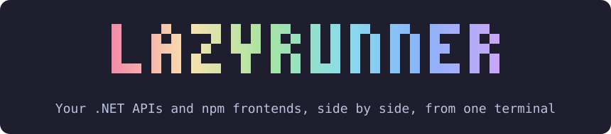
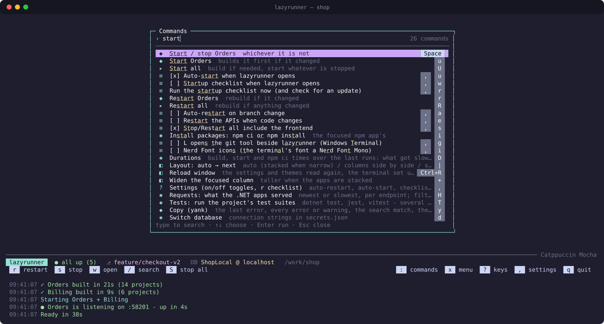
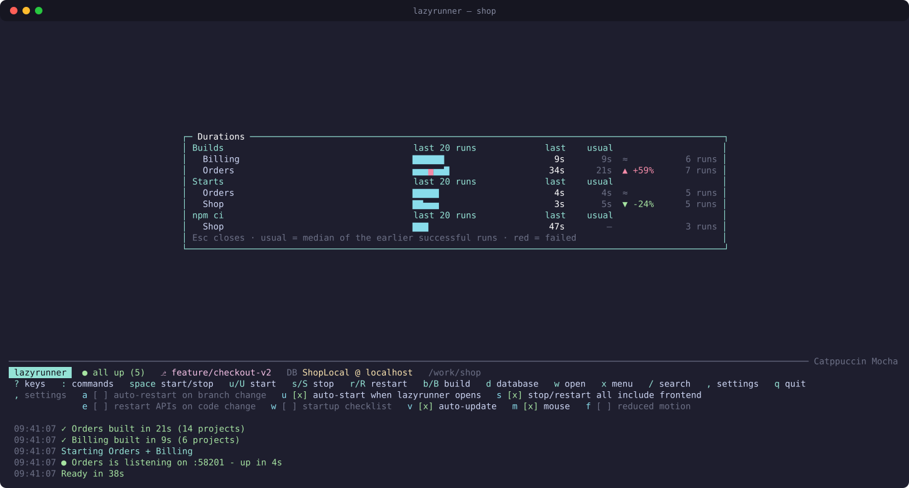
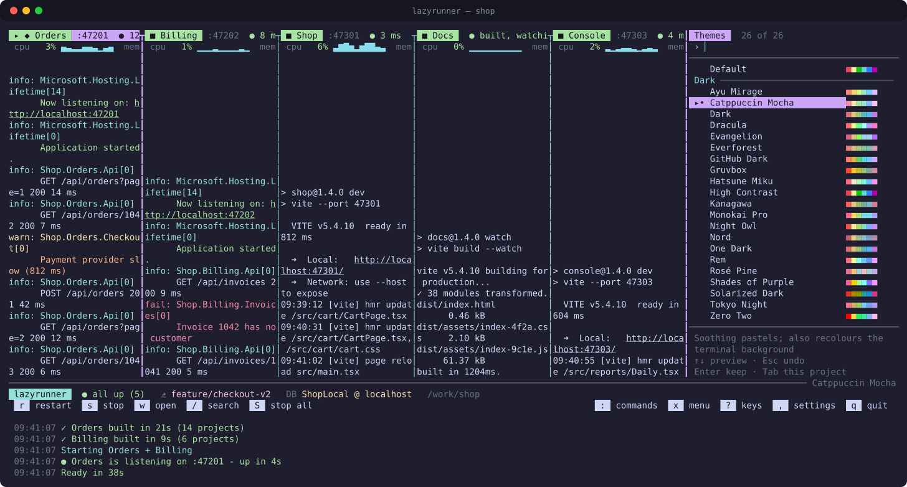
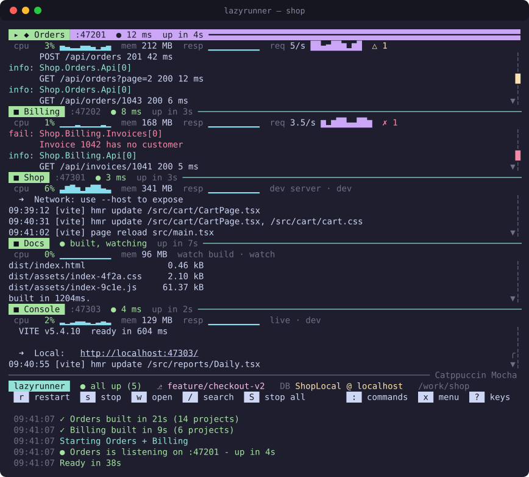
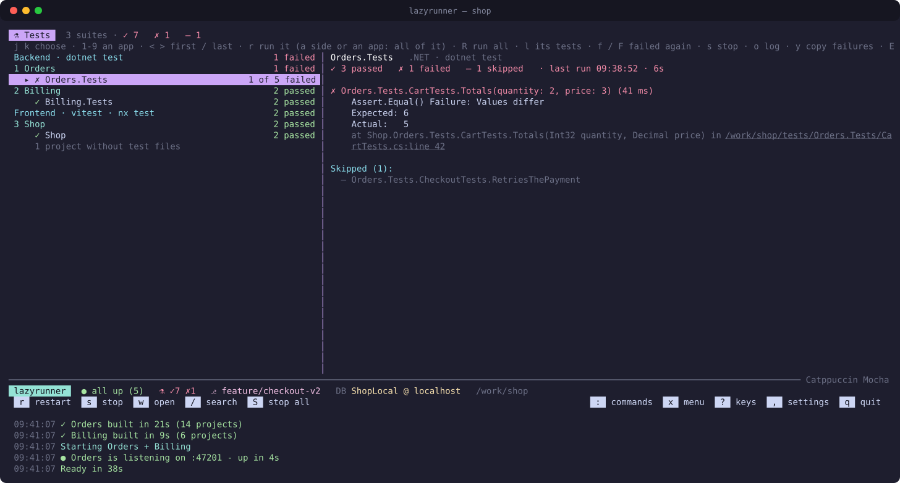
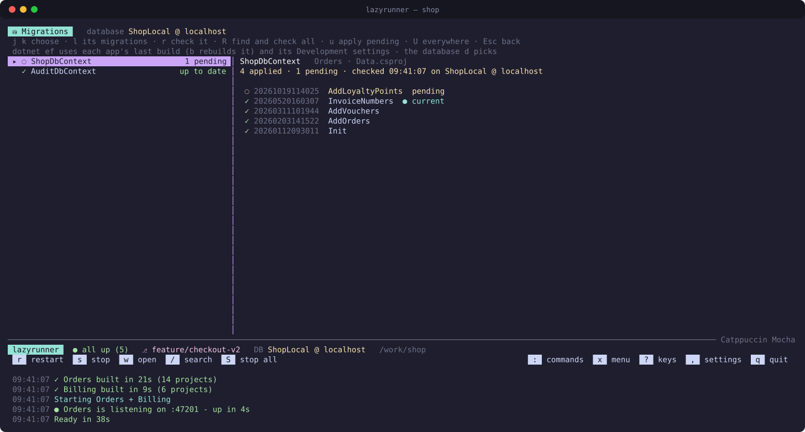
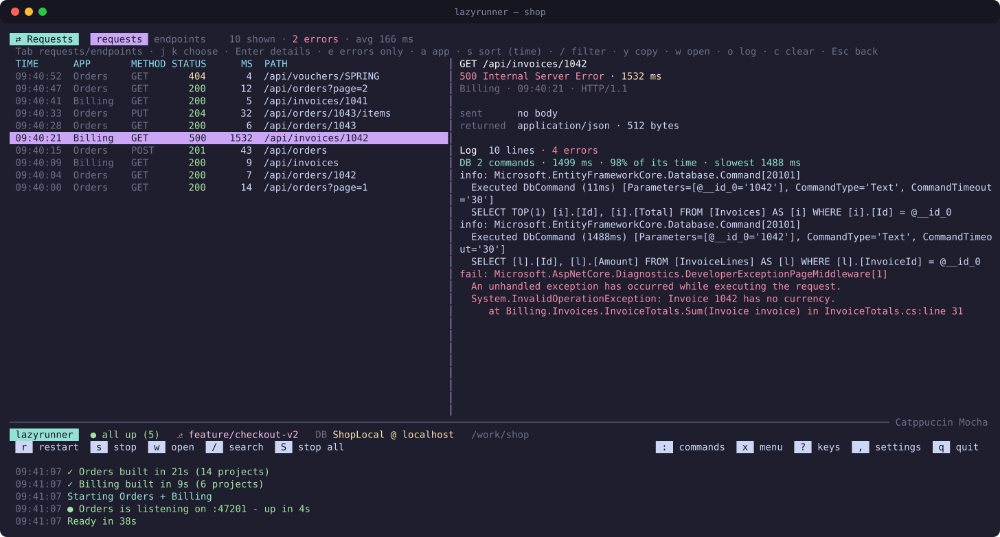
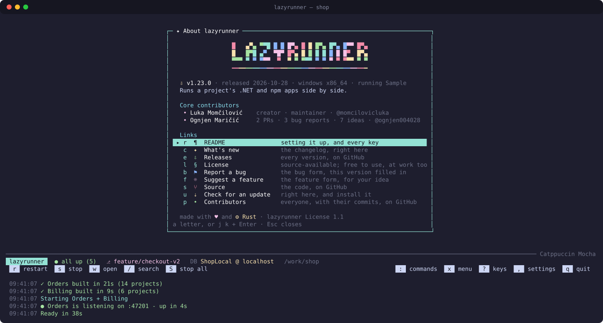

<p align="center"></p>

<p align="center">
  <a href="https://github.com/momcilovicluka/lazyrunner/actions/workflows/rust.yml"></a>
  <a href="https://github.com/momcilovicluka/lazyrunner/releases/latest"></a>
  <a href="https://github.com/momcilovicluka/lazyrunner/releases"></a>
  <a href="https://github.com/momcilovicluka/lazyrunner/blob/main/LICENSE"></a>
  <a href="https://github.com/momcilovicluka/lazyrunner/releases"></a>
  <a href="https://ko-fi.com/L4L2NNFN1"></a>
</p>

**Run your entire local development stack from one terminal.**

lazyrunner is a Rust terminal UI for running .NET APIs and npm frontends side by side. It builds what changed, starts
everything on the right ports, tells you when each app is up, and keeps live logs in columns you can scroll, search
and zoom.

Inspired by lazygit: one command instead of a row of terminal tabs.

<p align="center"></p>

> [!IMPORTANT]
> lazyrunner is source-available, not open source. It is free to use - personally, for a non-profit, or at work -
> under the [lazyrunner License](LICENSE). Redistributing it or selling it needs written permission.

## Features

- **One terminal for your stack** — run backend and frontend apps side by side.
- **Smart builds** — .NET builds run one at a time and skip unchanged work.
- **Live logs** — follow, search, and zoom each app's output.
- **Process management** — start/stop/restart apps while cleaning up child processes.
- **Project profiles** — keep stack setup in a shareable `.lazyrunner.json`.
- **Keyboard-first workflow** — fast controls inspired by lazygit.
- **Agent-ready** — `lazyrunner mcp` lets Claude Code read and drive the lazyrunner you watch.

## Quick start

Install lazyrunner, open a repository with your apps, then:

```sh
lazyrunner profile init --save
lazyrunner
```

Review the generated profile before the first run. See [Set up a project](#set-up-a-project) for profile details.

Windows binaries are published on the [releases page](https://github.com/momcilovicluka/lazyrunner/releases). Linux
and macOS currently build from source.

## Preview


<table>
  <tr>
    <td></td>
    <td></td>
  </tr>
  <tr>
    <td align="center"><code>:</code> the command palette</td>
    <td align="center"><code>D</code> how long builds and starts took</td>
  </tr>
  <tr>
    <td></td>
    <td></td>
  </tr>
  <tr>
    <td align="center"><code>t</code> themes, previewed live</td>
    <td align="center"><code>|</code> a narrow terminal stacks the apps</td>
  </tr>
  <tr>
    <td></td>
    <td></td>
  </tr>
  <tr>
    <td align="center"><code>T</code> the tests, run and read</td>
    <td align="center"><code>M</code> the migrations, applied and pending</td>
  </tr>
  <tr>
    <td></td>
    <td></td>
  </tr>
  <tr>
    <td align="center"><code>H</code> the requests the APIs served</td>
    <td align="center"><code>, A</code> about lazyrunner</td>
  </tr>
</table>

- **.NET apps** are built with `dotnet build` (one at a time, skipped when nothing changed) and run with their launch
  profile; the port comes from `launchSettings.json`.
- **npm apps** run their dev server or watch build; which script runs can differ per branch.
- Every app runs as a process tree lazyrunner owns (a job object on Windows, a process group on Linux and macOS): `q`,
  or even closing the terminal, leaves nothing running.
- What a project runs is described in a small JSON **profile** - in the repo (`.lazyrunner.json`) or in your own
  folder. `lazyrunner profile init` writes a first one for you.

## Install

In PowerShell:

```powershell
powershell -ExecutionPolicy Bypass -c "irm https://github.com/momcilovicluka/lazyrunner/releases/latest/download/lazyrunner-installer.ps1 | iex"
```

It puts `lazyrunner.exe` in `%USERPROFILE%\.local\bin` and adds that to your PATH. On Linux or macOS, build it from
source (with [Rust](https://rustup.rs)): `cargo install --locked --git https://github.com/momcilovicluka/lazyrunner lazyrunner`.

Then open a new terminal and run `lazyrunner` in your repo. A shorter name: add an alias of your own
(`Set-Alias lr lazyrunner` in your PowerShell profile, `alias lr=lazyrunner` in your shell's).

**Updating:** lazyrunner updates itself. When it opens, its startup checklist (or a quiet check when the checklist is
off, in the background) asks the GitHub releases for the latest version, installs a higher one, reopens on it and shows
what's new; `lazyrunner update` does the same on demand. With apps running, the new version takes them over when it
opens (Windows): they keep running, on the same ports, with their output. Downloads come over HTTPS only, the release's SHA-256
catches a broken download, and the new binary has to run before it replaces the old one. `,` then `v` (or `"autoUpdate": false`) turns it
off; `lazyrunner version` shows the version and where updates come from.

**Requirements:** git; the .NET SDK for .NET apps and Node.js / npm for npm apps (nvm works). Any terminal works;
Windows Terminal is best (tab colours and progress).

## Set up a project

lazyrunner needs a profile that says what your project runs. In your repo:

```sh
lazyrunner profile init          # prints a first profile from what it finds: .NET projects with a launch profile, npm dev scripts
lazyrunner profile init --save   # writes it to .lazyrunner.json
lazyrunner profile check         # checks it against the repo: projects, launch profiles, scripts, ports
```

A small one looks like this:

```json
{
  "schemaVersion": 1,
  "id": "shop",
  "name": "Shop",
  "watch": ["services"],
  "apps": [
    { "key": "api", "name": "API", "type": "dotnet", "project": "services/Api/Api.csproj", "launchProfile": "Api", "swagger": "/swagger" },
    { "key": "web", "name": "Web", "type": "npm", "dir": "web", "variants": [{ "script": "dev", "port": 5173 }] }
  ]
}
```

Commit `.lazyrunner.json` to share it with your team, or keep it in your own profiles folder (`projects` in the
settings folder, below) for yourself. The first time lazyrunner meets a repo's profile (and whenever it changes) it
shows what it would run and asks you to trust it. [projects/README.md](projects/README.md) is the full guide: where
lazyrunner looks, every field, recipes (watch builds served by an API, per-branch variants, a team's changes to a
profile), and how to write a profile for any repo - written so an LLM can follow it too.

## Example stacks

- **.NET API + React/Vite frontend**: one `dotnet` app and one `npm` app variant (`dev`, `port`).
- **Multi-service backend**: multiple `dotnet` apps in one profile, each with its own launch profile and port.
- **Frontend watch build served by API**: an `npm` watch variant with `servedBy` and `ready.file`.

See [projects/README.md](projects/README.md) for full examples and recipes.

## Commands

```
lazyrunner            open lazyrunner in this terminal and start everything (unless auto-start is off)
lazyrunner start      the same, but always starts; if lazyrunner is open in another terminal, starts what is stopped there
lazyrunner stop       stop everything in the open lazyrunner (also cancels a running build)
lazyrunner restart    stop, rebuild if anything changed, run again
lazyrunner profile …  init / check a project profile (above)
lazyrunner update     update lazyrunner now (also when auto-update is off)
lazyrunner version    the installed version, where updates come from, and what's new in it
lazyrunner mcp        an MCP server for an agent such as Claude Code (below)
lazyrunner help
```

`lazyrunner start` in another checkout of the same project while lazyrunner is open switches it there; in another
project's checkout it reopens there, with that project's apps and settings.

## Keys

The keys follow vim and lazygit. Letters are case-sensitive: **lowercase acts on the focused column, uppercase on
every app**. `?` shows them all, and `:` (or `Ctrl+P`) finds any command by name.

The line under the header shows the keys that matter now, as keycaps: on the left what the focused app can do as it
is - start or build it stopped, restart, stop or open it running, cancel what it's busy with, look at what went wrong
when it crashed - with search and start or stop all, and the alerts (a port in use, a changed package-lock.json); on
the right `:` commands, `x` the focused app's menu, `?` keys, `,` settings and `q` quit, which give way first in a
narrow terminal.

The command palette lists every command and setting with its keys as keycaps, grouped (Run, Tools, View, Help,
Settings) until you type; then the best matches come first with the typed letters lit. What acts on the focused app
names it and shows its icon ("Start Orders"). The selection bar slides to the chosen row, and Enter runs the command
at once while the palette wipes away.

**Run**

| Key | Action |
|-----|--------|
| `space` | Start or stop the focused app, whichever it isn't |
| `u` / `U` | Start the focused app / start everything (builds first if the code changed) |
| `s` / `S` | Stop the focused app (or cancel its build or `npm ci`) / stop everything, cancelling a running build - `S` also cancels it from inside the `,` and `x` menus, which stay open |
| `r` / `R` | Restart the focused app / everything (rebuild if anything changed) |
| `b` / `B` | Build the focused app / every app that builds (but the ones `S` leaves running): a full build, never skipped, that leaves them **stopped** (a running one is stopped first - it locks its build output). `u` / `U` then start them without building again. npm apps have no separate build step |
| `!` | Kill whatever holds a port the apps need (offered when a port is taken) |
| `q` / `Ctrl+C` | Quit: stop everything, back to the prompt |

**Tools**

| Key | Action |
|-----|--------|
| `d` | **Database picker**: switch the active connection string in the .NET apps' user secrets (below) |
| `i` | Install an npm app's packages in the background: `c` `npm ci`, `n` `npm install` (it stops the app first and starts it again after) |
| `w` / `W` | Open the focused app in the browser (Swagger for an API) / open everything |
| `o` | Open the focused app's full log file (or the failed build's log) |
| `y` | Copy from the focused app's output - it asks what: `y` the last error with its stack trace (a failed build's errors with full paths), `e` every error, `w` every warning, `a` both in order (repeats once), `s` the search match, `o` all of it |
| `D` | **Durations**: how long each build, app start, `npm ci` and test suite took over its last runs (below) |
| `M` | **Migrations**: the EF Core migrations, applied and pending, per DbContext; apply or roll back (below) |
| `H` | **Requests**: the HTTP requests the .NET apps served, per endpoint too (below) |
| `T` | **Tests**: the project's test suites - run them in the background, see what failed, run one test (below) |
| `L` | **lazygit** (or your `gitTool`) without leaving lazyrunner (below) |
| `x` | Menu of everything you can do with the focused app |
| `,` | **Settings** menu (below) |

**Moving around and view**

| Key | Action |
|-----|--------|
| `h` / `l`, `Tab` / `Shift+Tab`, `←` `→` | Focus the previous / next column |
| `1`-`9` | Jump to a column |
| `j` / `k`, `↓` `↑` | Scroll the focused column one line |
| `Ctrl+d` / `Ctrl+u`, `Ctrl+f` / `Ctrl+b`, `PgDn` `PgUp` | Scroll half a page / a page |
| `gg` / `G` (`Home` / `End`) | Oldest output / follow new output again |
| `/`, `n` / `N`, `Esc` | Search the focused column (matches highlighted), older / newer match, clear |
| `z` | Zoom: only the focused column |
| `+` / `-` / `=` | Widen / narrow the focused column (taller / shorter when stacked) / make all equal (saved) |
| `<` / `>` | The first / last: the oldest output and following new output again in a column, the first and last item in a list or box (as in lazygit) |
| `\|` | Layout: auto (stacked below 120 cells) → columns side by side → stacked top to bottom (saved) |
| `Ctrl+L` | Clear all columns and the panel log |
| `Ctrl+R` | **Reload window**, like VS Code's: reads the settings and themes again, sets the terminal up again (screen, mouse, tab, colours) and repaints - with a little CRT show (none with reduced motion). The apps keep running. Handy after editing a setting or a theme by hand, or when the terminal got garbled |
| `t` | Theme picker: preview each theme live, `Enter` keeps one (saved), `Esc` undoes; see [Themes](#themes) |
| `?` | Key reference |
| `:` / `Ctrl+P` | Command palette: fuzzy-find any action or setting |

**Settings (`,` then a letter)**, saved in `lazyrunner.config.json` (the letter highlights the setting it flips):

| Key | Setting |
|-----|---------|
| `a` | Auto-restart when the git branch changes |
| `u` | Auto-start when lazyrunner opens |
| `s` | Stop/Restart all include the npm apps (off: `S` / `R` leave them running) |
| `e` | Restart the .NET apps when code changes: once saving in the watched folder has been quiet for 2 s, rebuild and restart the running ones (npm apps have their own watchers) |
| `w` | Startup checklist when lazyrunner opens |
| `r` | Run the startup checklist now (and check for an update) |
| `p` | Reload the project profile (reopens lazyrunner; on Windows the running apps carry on, unless their entry changed) |
| `P` | Open the project profile in your editor (`"editor"`): the `.lazyrunner.json` lazyrunner runs, or your own |
| `v` | Auto-update lazyrunner when it opens |
| `m` | The mouse (below); off, the terminal selects text again |
| `f` | Reduced motion: nothing blinks, spins, glides or fades |
| `g` | `L` opens the git tool beside lazyrunner, in a Windows Terminal pane |
| `i` | Nerd Font icons (on by default): the title bars, the status line, the views' headers and marks |
| `o` | `M` checks the migrations against the database when it opens (off: `r` / `R` in it) |
| `l` | Links in the output open on Alt+click (on by default; off: on a plain click) |
| `c` | What's new: the changelog |
| `A` | About lazyrunner (below) |

**About lazyrunner** (`,` then `A`, or `:` about): the version and when it was released, who makes lazyrunner, and
its links - a letter (or `j` `k` and Enter, or a double click) opens the README, the changelog, the releases, the
license, a bug report with the version and OS already filled in, a feature request or the source, or checks for an
update right there (`u`: what the check is doing, then how it ended, under its link; an update it finds is installed,
as the startup checklist does). Its logo shimmers in rainbow colours over a flowing rule (still with reduced motion), with Nerd Font icons
when they're on.

### Mouse

A click focuses a column; a double click on its title zooms it (again: back). A link in the output - a URL, or a
place in a file, which opens in your editor (`"editor"`) at its line - opens on Alt+click, so a click to focus a column
never opens one by accident; `,` then `l` makes a plain click open them. Ctrl+click works too where the terminal leaves
it alone: Windows Terminal opens the URLs it finds itself on Ctrl+click, row by row, so a wrapped one comes out cut. A
file's path may be relative to its app's folder (an Angular app's `libs/...`) or to the repo. The wheel scrolls the column under the
pointer, whichever has the focus. In the menus, the command palette and the database and theme pickers a click picks
an item and a double click runs it; a click outside a box closes it. What the
pointer is over lights up, and what you click shows pressed for a moment. While the mouse is on, the terminal leaves text selection to
lazyrunner, which has none: `,` then `m` turns it off (in Windows Terminal, Shift + drag selects either way).

### Motion

lazyrunner answers what you do at once, and shows it: the hint of the key you pressed and the column it acts on
flash, the column that gets the focus pulses, a box opens from its middle, a setting flashes as it flips, copied lines
light up in their column, the line the search jumps to flashes, and column widths and scrolling glide. Long work moves
for as long as it lasts: builds, starts, npm, tests and migrations have a spinner and a bar against the usual time,
and with `restartOnCodeChange` a saved change counts down to the rebuild. None of it holds you up - a key acts at once,
also during the startup checklist or the reload show, which it ends. `, f` (reduced motion) turns it all off.

### During a build

.NET builds run one at a time; `R`, `B`, `r`, `b`, `U` and `!` wait for the current one (`S` cancels it). Everything
else keeps working: the database picker, `npm ci` next to the build, starting an npm app, `s` to cancel just the
focused app's build or take it out of the queue, and `q`.

## What it shows

- **Each column's title:** a spinner and progress bar while building or starting, with an estimate from previous runs
  (`23s / ~41s`); a pulsing dot until the app is up; then its URL, response time (`12 ms`, `slow 1.4s`, `not
  responding`) and how long it took to start. The response time comes from requesting the app's Swagger page (`/`
  otherwise) every 5 s.
- **The layout:** the apps side by side, or top to bottom when the terminal is narrower than 120 cells (a Windows
  Terminal pane, a laptop screen); `|` picks one for good.
- **Each column's info line:** CPU and memory of the app's whole process tree with sparklines, requests per second for
  .NET apps, and error / warning counters.
- **Builds** show real progress: projects done out of those in the dependency graph (`23/41`), warnings counted
  instead of flooding the column.
- **Log lines** are coloured by level, and every app's full output is saved to `<project>/logs/<app>.log` in the
  state folder (below), so `o` lets you search all of it.
- **Links** in output are underlined: URLs, and places in files - a build error's `Orders.cs(12,5)`, a .NET stack
  frame's `in …\Checkout.cs:line 42`, a node or jest frame's `src/cart.ts:12:5`. A click opens a URL in the browser
  and a file at its line in your editor (`"editor"`); a bare file name is looked for in the project, outside build
  output and `node_modules`.
- **A scrollbar** on the right of a column with more output than fits shows where the lines on screen are; it is
  bright while the column is scrolled back (`G` follows new output again).
- **The terminal tab** title and progress show the overall state; **desktop notifications** cover a failed build, a
  crash, and a slow start finishing.
- **After "Ready"**, the log shows a startup timeline per app.

## Startup checklist

When lazyrunner opens, a short splash checks for a lazyrunner update, git, the .NET SDK and Node.js / npm, whether the
apps' ports are free, whether the active database's server answers, each npm app's packages against its
`package-lock.json`, and which project and branch it runs. The checks run side by side. The apps don't wait long for
the update check: once everything else is done it gets 2 s more, then goes on in the background (an update it installs
is switched to when nothing is in the way). Problems also go to the panel log. Once every check is done, `r` runs the
ones that failed or warned again - a failed update, a port that was busy - without closing it; any other key closes it.
At startup it moves on by itself after a few seconds, the time left draining along its bottom edge. Opened by hand
(`,` then `r`), or once you've pressed `r`, it stays up while there is something to retry, until a key closes it.
Turn it off with `,` then `w`.

## Database picker (`d`)

.NET apps that use user secrets read their connection strings from `secrets.json` in the user secrets folder
(`%APPDATA%\Microsoft\UserSecrets\<id>\` on Windows, `~/.microsoft/usersecrets/<id>/` elsewhere). lazyrunner lists
every SQL connection string there as `database @ server`, never showing passwords. Choosing one makes that line active
and comments out (`//`) the others with the same key, checks the file is still valid JSON, keeps the previous version
as `secrets.json.lazyrunner-backup`, and restarts the running .NET apps (no build needed). `n` adds an entry: a copy
of the selected one with another database name; `y` copies the highlighted line as it is in the file,
password included.

## lazygit (`L`)

`L` opens [lazygit](https://github.com/jesseduffield/lazygit) in the project's folder without leaving lazyrunner. It
takes over this terminal; `q` in lazygit brings lazyrunner back. Meanwhile the apps keep running and lazyrunner keeps
watching them (a branch you switch to in lazygit restarts them as usual, if that setting is on), and quitting or an
update waits until you're back. With `,` then `g` in Windows Terminal, `L` opens lazygit in a pane beside lazyrunner
instead, so you see both. Another git tool: `"gitTool"` (for example `"gitui"`). lazygit has to be installed (`winget
install JesseDuffield.lazygit`, `scoop install lazygit`).

## Migrations (`M`)

`M` shows the DbContexts on the left and the selected one's migrations on the right, newest first: applied (✓), pending (◌) and the current one, as the database the app uses
has them. `dotnet ef` (`dotnet tool install --global dotnet-ef`) runs with the app's project as the startup project,
its Development settings - so the database you picked with `d` - and its last build (`b` rebuilds it); in the
background, one job at a time, waiting while an app builds.

```json
{ "key": "api", "type": "dotnet", "project": "src/Api/Api.csproj", "launchProfile": "Api",
  "migrations": { "project": "src/Data/Data.csproj", "contexts": ["ShopDbContext"] } }
```

lazyrunner finds them by itself: the EF Core model snapshots (`*ModelSnapshot.cs`) in each .NET app's project and the
projects it builds, and the DbContext each is of - a project once, for the first app that builds it, which is the
startup project. `"migrations"` in an app's profile says where instead (above): `project` is the one with the
migrations (the app's own when left out), and without `contexts` its model snapshots name them, else
`dotnet ef dbcontext list` finds them.

Checking a context against the database takes `dotnet ef` a few seconds, so `M` doesn't by itself: `r` checks the
selected context, `R` finds the contexts again (a branch may add some) and checks them all. With
`checkMigrationsOnOpen` (`, o`) `M` checks them all each time it opens, and switching the database or the branch
checks them again. Each check is kept, per database, for the next run: a context shows its last check on the database
you picked - when, with the day once it isn't today - or "not checked" when it has none there. `l` chooses a migration, `m` moves the context to it - forward
applies up to it, back reverts the newer ones through their `Down()` - and `u` applies what's pending (`U`: in every
context); each asks first, naming the database.

## Requests (`H`)

An API that logs through Serilog (or anything else that replaces ASP.NET's logging) to somewhere other than the
console - Seq, Application Insights - prints no request for lazyrunner to read, and the view says which one when it
stays empty. `"args"` in that app's profile passes it what turns that off for local runs, after `dotnet run ... --`;
an app that only logs to Seq when it has a Seq key, say:

```json
{ "key": "api", "type": "dotnet", "project": "src/Api/Api.csproj", "launchProfile": "Api", "args": ["--Seq:ApiKey="] }
```

lazyrunner starts the .NET apps with ASP.NET's request log turned on (`--Logging:LogLevel:Microsoft.AspNetCore.
Hosting.Diagnostics=Information`) and keeps those lines out of the columns: `H` lists the requests instead - time,
app, method, status, milliseconds and path, newest first (`s`: slowest first). Serilog's request logging (`HTTP GET /x
responded 200 in 12 ms`) shows too. `Tab` sums them up per endpoint (ids in paths become `{id}`): count, errors,
average, 95th percentile and slowest, sorted by total time (`s` for the others).

`Enter` (or `Space`, or a double click) shows the selected row's details in a panel on the right, and again hides
it; `Esc` hides it too. A request's: its status,
time, protocol, what it sent and returned, and - once its endpoint has a few requests - how it compares with them (p50,
p95). Below, what the app logged while it ran, from ASP.NET's "Request starting" line to its "Request finished" one:
the line count, the errors, the EF Core database commands (`Executed DbCommand`: how many, their total time and its
share of the request's, the slowest), then the lines themselves, the newest that fit. When other requests of the app ran
at the same time some of those lines may be theirs, and the panel says so. An endpoint's: count and errors, average,
p50, p95 and slowest, a sparkline of its latest times, its statuses, its slowest and its latest failing requests.
Serilog's request log has no start line, so its requests come without their log lines.

A request that runs the same query 10 times or more (its parameters aside) looks like an N+1 - a loop loading one row
at a time: its row says `N+1`, its details show the query, how often and how long it ran, and its endpoint's say how
many of its requests do it. lazyrunner sums a request's database commands up as it finishes, so they stay after its
log lines scroll away.

`l` (or →) on an endpoint lists its requests; `h` (or ←, `Tab`, `Esc`) goes back to it. `e` shows errors only, `a` one
app, `/` filters by path; `y` copies the selected row, `w` opens a GET request in the
browser, `o` opens the selected row's app log, `c` clears the list, `Esc` / `q` / `H` close. The top row follows new requests; any other
row stays put as new ones arrive. The last 5,000 are kept while lazyrunner runs (lazyrunner's own response-time probe
isn't among them); the full lines are still in each app's log file.

## Tests (`T`)

`T` finds the project's test suites and lists them on the left - the backend, then the frontend, and in each the
profile's apps with their suites - the selected one on the right:

- **.NET**: every project referencing `Microsoft.NET.Test.Sdk` (NUnit, xUnit and MSTest alike), run with `dotnet
  test`. The queued ones build together first, in one MSBuild run, so the projects they share build once; then they
  run side by side without building again. An app's build pauses that test build, which runs again after it.
- **npm**: an npm app whose `test` script runs jest or vitest; in an Nx workspace, each project with tests (`nx test`).
  `npm ci` pauses the suites that run from its folder.

A .NET test project belongs to the app whose project it references, an npm or Nx suite to the npm app whose folder
it runs in; an app's `"tests"` in the profile (test project paths or names, Nx project names) says otherwise. Choose
Backend, Frontend or an app and `r` (or a click on it - the pointer on one says so) runs all of its suites; `1`-`9`
jump to the apps' sections, numbered in the list. A box opened from the tests or requests view (`,` settings, `?`,
`d`…) goes back to the view when it closes.

`r` runs the selected suite, `R` all of them, `f` / `F` only their failed tests again (the results merge into the last
full run's). Up to `testParallelism` suites run at once (half the cores by default), in the background: close the view
and the apps keep running, the panel says `testing 2 +3 queued`, the log says how each suite did, and a notification
comes when something failed. While a suite runs the right side shows its output; afterwards its failures with their
message and their own stack frames (a place in a file opens in your editor on a click), or its slowest tests when all
passed. `y` copies the failures, `o` opens the suite's whole log, `s` stops the tests, `Esc` / `q` / `T` close.

`l` opens the selected suite's tests (the failed first, then the skipped and the passed) to pick one: `j` `k` choose,
the right side shows its message and stack, `r` runs just that test (its result joins the suite's), `y` copies it,
`h` goes back to the suites. A click picks a test, a double click runs it. The
last results are kept, so they're still there after a restart, and each suite's time shows in `D`. The panel's
status line sums them up - `⚗ ✓438 ✗13` (red when something failed), `⚗ testing 6 +10 queued` while they run - and a
click on it opens `T`.

## Durations (`D`)

Every build, app start, `npm ci` and test suite is timed and kept (the last 40 of each) in `history.json` in the project's state
folder. `D` shows them in a box, grouped:

| Column | Meaning |
|---|---|
| bars | One bar per run, scaled to the item's slowest; red = it failed |
| last | The latest run (red when it failed) |
| usual | Median of the up to 10 successful runs before it (once there are 3) |
| ▲ / ▼ | The latest run 15% (and a second) or more slower (red) / faster (green) than usual; `≈` closer; nothing after a failed run |

When a run finishes notably off its usual, its log line says so, e.g.
`✓ Orders built in 52s (41 projects) · 37% slower than usual (38s)`. A cancelled build or `npm ci` isn't recorded; an
unreadable `history.json` is kept as `history.json.bad` and a new one starts.
`j` `k` scroll, `Esc` / `q` / `D` close.

## Agents (MCP)

`lazyrunner mcp` is an MCP server for an agent such as Claude Code. The agent reads and drives the lazyrunner you have
open, and you watch it happen there: each of its actions shows in the log, as `▸ claude-code: build Orders`.
Register it once:

```bash
claude mcp add --scope user lazyrunner -- lazyrunner mcp
```

| Tool | What it does |
|------|--------------|
| `get_status` | Each app's state, port, url and error count; what's busy; the test totals; the settings; what's on screen |
| `get_logs` | An app's output, numbered: `since` (only what's new), `limit`, `grep`, `errors_only` |
| `get_errors` | An app's last error with its stack (a failed build's errors, with full paths), or every error or warning |
| `get_requests` | The requests the .NET apps served: newest or slowest first, `since`, one app, errors only, a path, one endpoint - or summed up per endpoint (p50, p95, max); N+1s marked |
| `get_request` | One request in full: what it sent and returned, its endpoint's times, the log lines and database commands it caused, the query it repeated (an N+1) |
| `get_screen` | The screen as you see it, as text |
| `start_apps`, `stop_apps`, `restart_apps`, `build` | An app, or every app |
| `wait` | Until `ready`, `build_done`, `tests_done` or `migrations_checked` (10 minutes at most), then how it went |
| `list_tests`, `get_test_results`, `run_tests`, `stop_tests` | The tests view's suites and results; run all, a suite, its failed tests or one test |
| `get_migrations`, `check_migrations` | The migrations view's DbContexts as last checked; check one, or all, against the database |

It asks from anywhere, but acts only in the checkout lazyrunner runs (or a folder in it): an agent working in another
worktree is told to have you open lazyrunner there. Its actions follow the keys' rules while an app builds. Applying
or rolling back migrations, switching the database and killing what holds a port stay yours. When lazyrunner isn't
open, the tools say so; open it and the agent carries on. Run lazyrunner and the agent at the same level: Windows
doesn't let an agent that isn't elevated drive a lazyrunner opened with "Run as administrator". After an update, restart lazyrunner (`q`, then
`lazyrunner`) so it speaks the same version as `lazyrunner mcp`. To let Claude Code read without asking each time,
allow `mcp__lazyrunner__get_status`, `mcp__lazyrunner__get_logs`, `mcp__lazyrunner__get_errors`,
`mcp__lazyrunner__get_screen`, `mcp__lazyrunner__get_requests`, `mcp__lazyrunner__get_request`,
`mcp__lazyrunner__list_tests`, `mcp__lazyrunner__get_test_results`,
`mcp__lazyrunner__get_migrations` and `mcp__lazyrunner__wait` in its permissions.

## npm apps

Which script an npm app runs is decided on every start from its `package.json` (the profile's variants), so a branch
can use a dev server and another a watch build. npm apps start right away and compile while the .NET apps build.
Automatic restarts leave them alone, since `npm run` watches its own files - unless a branch needs another variant.
`i` installs packages in the background and asks how: `c` runs `npm ci` (a clean install of exactly what
`package-lock.json` says), `n` runs `npm install` (adds and updates packages to match `package.json`; the lock file may
change). Both stop the app first and start it again after, and pause the test suites that run from its folder. Once
you've installed from lazyrunner, it warns when `package-lock.json` changes.

## Nerd Font icons

lazyrunner draws Nerd Font icons in its chrome (`nerdIcons`, on by default; `, i` turns them off). An app's title bar
shows the .NET logo, or for an npm app its framework's - Angular, React or Vue, by its package.json - else Node.js's;
the status line a git branch and a database; the tests, requests and migrations views a flask, an exchange and a
database, and check, cross, warning, minus and clock marks for passed, failed, errors, skipped and queued (the startup
checklist's marks too). An app's `"icon"` is the one it has without them; `"nerdIcon"` in its profile gives it one with
them, as PowerShell's lazybms had - `"\uf0ac"` a globe, `"\uf085"` cogs, any icon on
[the Nerd Fonts cheat sheet](https://www.nerdfonts.com/cheat-sheet). Text written into the columns and the log stays as
it is.

They need a terminal font that is a Nerd Font, a "Mono" one so each icon is one cell wide -
[CaskaydiaCove Nerd Font Mono](https://www.nerdfonts.com/font-downloads) goes well with Windows Terminal. Boxes or
question marks instead of icons mean the font isn't one: set one, or `, i` for plain symbols every font has.

## Themes

`t` opens the theme picker: a narrow panel on the right, so the rest of the screen shows each theme as you move through
the list (`↑` `↓`, `PgUp` `PgDn`), the terminal's background included. Typing filters by name, `Enter` keeps the
selected theme for every project (saved), `Tab` for this project alone - handy to tell two projects' windows apart (`◆`
marks it; `Enter` later gives the project back the shared one) - and `Esc` puts back the one you had. Built in:
`default` (your terminal's own palette), `dark`, `light`, `high-contrast`; the editors' favourites `one-dark`,
`github-dark`, `github-light`, `dracula`, `monokai-pro`, `nord`, `gruvbox`, `kanagawa`, `rose-pine`, `everforest`,
`ayu-mirage`, `night-owl`, `shades-of-purple`, `catppuccin-mocha`, `catppuccin-latte`, `tokyo-night`, `solarized-dark`
and `solarized-light`; and for anime fans `evangelion` (Unit-01), `zero-two`, `rem` and `hatsune-miku`. Most also
recolour the terminal background while lazyrunner runs. Your own: copy one from [themes/](themes/) to `themes/<id>.json`
in the settings folder and change it; the picker reads the themes again each time it opens, so it shows up straight
away. [themes/README.md](themes/README.md) describes every field.
`NO_COLOR` turns colour off.

## Configuration

`lazyrunner.config.json` is in the settings folder; lazyrunner writes it when you change a setting. The panel saves the
`,` settings, the theme and column widths there. Settings that depend on the project live in its section:

```json
{
  "repoRoot": "C:\\src\\shop",
  "autoStartOnOpen": true,
  "theme": "default",
  "projects": {
    "shop": { "columnWidths": { "api": 40, "web": 60 }, "apps": { "admin": { "enabled": false } } }
  }
}
```

| Key | Default | Meaning |
|-----|---------|---------|
| `repoRoot` | | The project used when you run lazyrunner outside any project |
| `autoStartOnOpen` | `true` | Build and start everything as soon as lazyrunner opens |
| `autoRestartOnBranchChange` | `false` | Restart when the git branch changes |
| `skipUnchangedBuilds` | `true` | Skip `dotnet build` when nothing in the watched folder changed since the last build |
| `restartOnCodeChange` | `false` | Rebuild + restart the running .NET apps when code changes |
| `notifications` | `true` | Desktop notifications |
| `startupChecklist` | `true` | The startup checklist |
| `panelLogLines` | `5` | How many recent events the panel shows |
| `theme` | `default` | A theme's id (a built-in one, or a file in `themes` without `.json`) |
| `autoUpdate` | `true` | Install a newer lazyrunner when it opens |
| `mouse` | `true` | Clicks and the wheel (off: the terminal selects text) |
| `reducedMotion` | `false` | No blinking, spinners, glides or fades |
| `gitTool` | `"lazygit"` | What `L` runs: a command (with arguments) on PATH or a path |
| `gitBeside` | `false` | `L` opens it beside lazyrunner (in Windows Terminal) instead of in place |
| `nerdIcons` | `true` | Nerd Font icons in the chrome; for a terminal whose font is a Nerd Font (a "Mono" one) |
| `checkMigrationsOnOpen` | `false` | `M` checks every DbContext against the database when it opens, and again after a database or branch switch |
| `linksOnAltClick` | `true` | Links in the output open on Alt+click (Ctrl+click too, where the terminal allows); off, on a plain click |
| `layout` | `"auto"` | `columns` side by side, `stacked` top to bottom, or `auto`: stacked when the terminal is narrower than 120 cells (`\|`) |
| `testParallelism` | half the cores | How many test suites `T` runs at once |
| `editor` | `"auto"` | Opens a clicked file link: `auto` (VS Code, else Rider, else the default app), `code`, `rider`, `default`, or a command with `{file}`, `{line}`, `{column}` |
| `updateRepoUrl` | | Where updates come from on this machine (a GitHub repo URL; `none`: no updates) |
| `projects.<id>.theme` | | This project's own theme, instead of `theme` (`t`, then `Tab`) |
| `projects.<id>.columnWidths` | equal | Relative width per app key, or height when stacked (`>` / `<` / `=`) |
| `projects.<id>.apps.<key>.enabled` | `true` | `false` leaves that app out on this machine |
| `projects.<id>.apps.<key>.includeInAll` | | `false` keeps that app running on Stop all / Restart all |
| `projects.<id>.frontend` | `true` | `false` leaves out every npm app |
| `projects.<id>.stopFrontendOnStop` | `true` | Stop/Restart all include the npm apps (`,` then `s`) |

**Where things live:**

| | Settings (`lazyrunner.config.json`, `projects/`, `themes/`) | State (`lazyrunner.log`, trusted profiles, per-project logs, timings and durations) |
|---|---|---|
| Windows | `%APPDATA%\lazyrunner` | `%LOCALAPPDATA%\lazyrunner` |
| macOS | `~/Library/Application Support/lazyrunner` | `~/Library/Application Support/lazyrunner/state` |
| Linux | `~/.config/lazyrunner` | `~/.local/state/lazyrunner` |

`LAZYRUNNER_CONFIG_PATH`, `LAZYRUNNER_PROFILES_DIR` and `LAZYRUNNER_STATE_DIR` replace them.

## Troubleshooting

- **Build failed:** the column shows the errors and `o` opens the full log.
- **A build was skipped but you want a clean one:** `b` (focused app) or `B` (everything) builds in full; `u` / `U`
  then start without building again.
- **Port already in use:** something else runs the app (an IDE, say). The panel names the process; `!` kills it and
  starts.
- **A port reserved by Windows:** Hyper-V, WSL and Docker reserve blocks of the dynamic range (49152-65535) at boot;
  nothing holds such a port, yet no app can listen on it ("access forbidden"). lazyrunner doesn't start that app, says
  so in the log and the startup checklist, and the others start. `net stop winnat`, then `net start winnat`, in an
  elevated terminal frees the ports (`netsh int ipv4 show excludedportrange protocol=tcp` lists them); for good, give
  the app a port below 49152.
- **An app is quiet:** some apps log to other sinks than the console; the `● … ms` in the title shows it's up and
  answering.
- **The terminal is too small:** lazyrunner needs at least 60×15; `z` zooms one column to full width, and `|` stacks
  the apps top to bottom.
- **The profile is wrong:** `lazyrunner profile check` names each problem and its field.

## Roadmap

What's next, in order, is on the [roadmap board](https://github.com/users/momcilovicluka/projects/3): feature requests
and fixes move Backlog → Next → In progress → Done, one release each. Further out:

- Publish Linux and macOS release binaries.
- Expand profile recipes for common multi-service setups.
- Keep improving startup diagnostics and recovery feedback in the UI.

## Development

lazyrunner is Rust ([Ratatui](https://ratatui.rs)), in `crates/`: `lazyrunner-core` (profiles, settings, apps,
processes, output, the self-update), `lazyrunner-ui` (the terminal UI) and `lazyrunner` (the binary).
[docs/parity.md](docs/parity.md) lists everything it does against the PowerShell version (0.1), which it replaces.

```
cargo run --release                                   # run the project in this folder
cargo run -- profile check                            # check the profile that applies here
cargo test --workspace                                # unit tests, snapshots of every screen, end-to-end tests
cargo insta review                                    # look at changed screen snapshots
LAZYRUNNER_WRITE_REFERENCE=1 cargo test -p lazyrunner-core reference   # rewrite the guide's field reference
cargo run -p lazyrunner-ui --example screenshots      # redraw the screenshots above (docs/screenshots) after visible changes
vhs docs/demo.tape                                    # record the demo GIF locally (docs/demo.gif, not committed)
dist plan                                             # what a release would build (cargo-dist)
```

The README's recording lives on the [`demo` release](https://github.com/momcilovicluka/lazyrunner/releases/tag/demo),
not in git: the `demo` workflow records it with VHS (`docs/demo.tape`, on the demo shop in `examples/demo`) and replaces
it there whenever the demo or its tape changes on `rust`, or when you run the workflow by hand.

The end-to-end tests run the sample repo with real dotnet, npm and node (skipped without them), and update an installed
copy of lazyrunner from a local stand-in for GitHub Releases.

### Releasing

A release is a tag: pushing `v1.2.3` builds the Windows binary and publishes the GitHub release with it, its
.sha256 and the PowerShell installer (`.github/workflows/release.yml`, made by cargo-dist from `dist-workspace.toml`;
after changing that file, `dist generate`). Installs pick it up the next time they open.

1. Add a section on top of [CHANGELOG.md](CHANGELOG.md): `## [0.2.1] - 2026-11-02` and what changed, under
   `### Added` / `### Changed` / `### Fixed`. Installs show it after they update.
2. Bump `version` under `[workspace.package]` in `Cargo.toml` (semantic versioning: a new feature 0.3.0, a fix 0.2.1).
3. Run the tests and `dist plan`, commit, then tag and push:

   ```sh
   git tag v0.2.1
   git push origin main v0.2.1
   ```

The repo has to be public: the installer and the self-update download its releases without signing in.

`main` takes changes through pull requests whose `lint` and `test` checks pass, with review comments resolved; the
maintainer merges the releases into it and is the only one who can push `v*` tags, so only they publish a release
(the repo's rulesets). Dependabot opens weekly updates for the crates and the actions against `rust`.

### Contributors (the About box)

The About box lists who makes lazyrunner from [contributors.json](contributors.json), which nobody edits by hand: the
`contributors` workflow (`.github/workflows/contributors.yml`) writes it from the repo whenever an issue is opened or
closed, a pull request is merged, and once a day. Code counts by merged pull requests (not commits: they change
with every push); bug reports and ideas by the issue forms' labels (`bug`, `enhancement`). Someone with a merged pull request or three issues is listed;
[.github/contributors-overrides.json](.github/contributors-overrides.json) pins people first (with a role or a name),
hides them, or changes those thresholds. To run it by hand: `GITHUB_TOKEN=<token> node .github/scripts/contributors.mjs`.

The workflow pushes with a deploy key (secret `CONTRIBUTORS_DEPLOY_KEY`), which `main`'s ruleset lets through.
The same run writes the README's [Contributors](#contributors) avatars between their markers. lazyrunner builds the
file in, and fetches the current one from `main` at most once a day as the update check runs
(not with auto-update off), into its state folder; offline it keeps the one it has. The workflow commits to `main`,
so pull before merging a branch into it.

## Community

- **Roadmap**: what's next is on the [roadmap board](https://github.com/users/momcilovicluka/projects/3) (and the
  [Up next](https://github.com/momcilovicluka/lazyrunner/milestone/1) milestone); further out, [Roadmap](#roadmap).
- **Questions**: [Discussions](https://github.com/momcilovicluka/lazyrunner/discussions), not issues.
- **Bugs and ideas**: the [issue forms](https://github.com/momcilovicluka/lazyrunner/issues/new/choose).
- **Contributing**: [CONTRIBUTING.md](CONTRIBUTING.md); everyone follows the [code of conduct](CODE_OF_CONDUCT.md).
- **Security problems**: privately, as [SECURITY.md](SECURITY.md) says.

## Contributors

Everyone who builds lazyrunner, or tells it what to do next - kept up to date from GitHub, like the About box
([README, "Contributors"](#contributors-the-about-box)):

<!-- contributors:start -->
<p>
<a href="https://github.com/momcilovicluka" title="Luka Momčilović (@momcilovicluka) - creator · maintainer"></a>
<a href="https://github.com/ognjen004028" title="Ognjen Maričić (@ognjen004028) - 2 PRs · 3 bug reports · 7 ideas"></a>
</p>
<!-- contributors:end -->

## License

lazyrunner is source-available, not open source: free to use as a tool for any purpose - personally, for a
non-profit, or at work, including for a company - under the [lazyrunner License](LICENSE). Copying, redistributing,
selling it or offering it as a product or service, and maintaining a separate fork are not allowed without written
permission from the author; ask through this repository.

Pull requests are welcome. Forking is allowed only to prepare them, and contributions come in under the Contributor
Agreement in [CONTRIBUTING.md](CONTRIBUTING.md).
